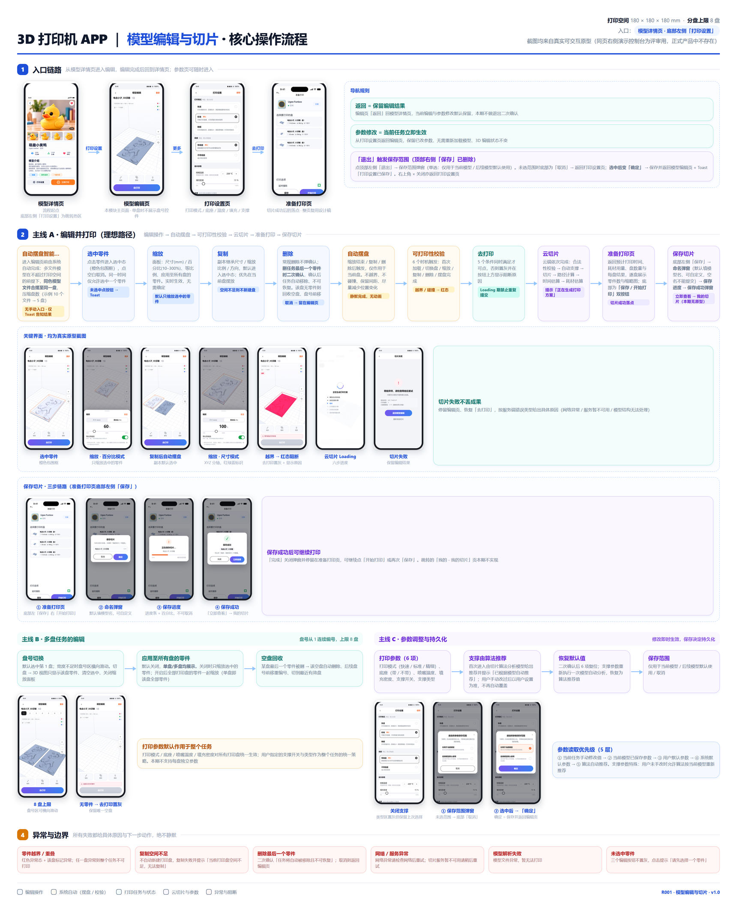
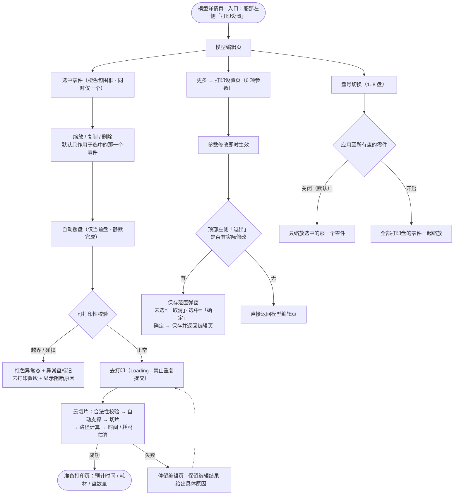

# 3D 打印机 APP｜模型编辑与切片模块 产品需求文档

> **文档版本**：v1.0（初版 · 待原型确认后细化）
> **所属产品线**：自研款 3D 打印机 APP
> **需求编号**：R001
> **最后更新**：2026-09-28

---

## 项目信息与版本记录

| 项 | 内容 |
|---|---|
| 需求编号 | R001 |
| 需求名称 | 模型编辑与切片 |
| 所属产品线 | 自研款 3D 打印机 APP |
| 文档版本 | v1.0 |
| 状态 | 🟡 初版（骨架 + 背景/目标/场景/功能逻辑已填充；详细方案原型链接与流程图待原型确认后补充） |
| 原型文件 | `../prototype/prototype_v1.0.html`（待生成） |
| 上游需求 | 模型详情页（`dayinlvchengv3/index.html#screen-model`） |
| 下游页面 | 准备打印页（`dayinji` 原型，本次移植进本原型，见 DEC-012） |

### 版本记录

| 版本 | 日期 | 修改内容 | 修改人 |
|---|---|---|---|
| v1.0 | 2026-09-28 | 初版：搭建标准文档骨架，填充需求背景、需求目标、用户与场景、功能清单与基础逻辑；详细方案与流程图待原型确认后补充 | AI 产品经理 |
| v1.0-r1 | 2026-09-28 | 原型评审修订：① 术语「模型」→「零件」（指打印盘上的单个可打印对象）② 准备打印页改为复用设计稿整图，**删除"打印参数摘要"与"算法判定需要支撑"标记** ③ 「应用至所有盘」更名为「应用至所有盘的零件」（其作用范围定义已被 r2 修正） | AI 产品经理 |
| v1.0-r8 | 2026-10-15 | 「退出即进入保存范围选择」补充**退出弹窗弹出规则**（BR-056 修订）：点顶部左侧「退出」时，**有实际修改** → 弹出「请选择参数保存范围」弹窗（原行为不变）；**无实际修改** → 不弹窗，**直接返回模型编辑页**。「实际修改」以**进入打印设置页时的参数快照**比对判定；深链直达弹窗不受影响 | AI 产品经理 |
| v1.0-r7 | 2026-10-12 | 新增「**自动摆盘智能优化**」（M16）：多文件模型在不超过打印空间的前提下，**同色模型文件自动合摆一盘**以减少盘数；进入模型编辑页展示优化结果 Toast（示例 10 个文件 → 5 盘）。**优化方案待与切片工程师确认**（DEC-068）。演示台新增独立演示分支 | AI 产品经理 |
| v1.0-r6 | 2026-10-08 | 打印设置页保存入口重构：**删除顶部右侧「保存」按钮**，保存范围弹窗改由**顶部左侧「退出」**触发；弹窗新增**右上角关闭**、列表项改为**单选选中态**、底部按钮**未选范围=「取消」/ 已选范围=「确定」**；点「确定」保存并返回模型编辑页 + Toast「打印设置已保存」 | AI 产品经理 |
| v1.0-r5 | 2026-09-29 | 准备打印页新增**保存切片**能力：底部由单个「开始打印」改为**左「保存」右「开始打印」双按钮**；保存链路为 命名弹窗 → 保存进度 → 保存成功弹窗（文案「可以在「我的 - 我的切片」中查看」+「立即查看」）。「我的切片」页本期不实现 | AI 产品经理 |
| v1.0-r4 | 2026-09-29 | 缩放作用范围修订：**「应用至所有盘的零件」在单盘模型下也展示**（不再仅多盘出现）；单盘开启后作用于该盘全部零件，副标题相应说明 | AI 产品经理 |
| v1.0-r3 | 2026-09-28 | 删除逻辑修订：**删除任务最后一个零件时新增二次确认**——弹窗提示「当前盘所有模型被删除后，任务将自动被移除且不可恢复。」，取消则返回模型编辑页不执行删除，确认后才执行且**任务自动移除**（取代原「保留空盘 + 去打印置灰」） | AI 产品经理 |
| v1.0-r2 | 2026-09-28 | 原型评审修订 2：**修正缩放作用范围**——「应用至所有盘的零件」改为**默认关闭**；关闭时缩放/重置只作用于选中的那一个零件，开启后才同步全部打印盘的零件。删除/复制始终只作用于选中的零件 | AI 产品经理 |

### 关联决策（来自 `_memory/DECISIONS.md`）

| 决策 | 内容 |
|---|---|
| DEC-001 | 3D 视图采用真 Three.js 可旋转模型 |
| DEC-002 / DEC-012 | 准备打印页复用既有实现，且采用单文件自洽（移植而非跨文件跳转） |
| DEC-003 | 云切片失败态提供手动触发开关 |
| DEC-004 / DEC-007 | 主流程走理想态，异常态保留可选演示 |
| DEC-005 | 删除「Choose your builder」页，模型编辑页取代之 |
| DEC-006 | 入口 = 模型详情页底部左侧「打印设置」按钮；返回落点 = 模型详情页 |
| DEC-008 | 分盘来自模型自带；原型提供 1 盘与 8 盘两套演示数据 |
| DEC-009 | 模型名称修改本期不实现 |
| DEC-010 | 保留原文案，命名不做统一 |
| DEC-013 | 3D 模型使用用户提供的 STL（电击小子_3D浮雕） |
| DEC-014 | 两套演示数据的支撑推荐结果错开 |
| DEC-015 | 埋点必须写进 PRD |
| DEC-016 | 4 个业务目标值采用 AI 拟定值 |
| DEC-017 | 授权 AI 补齐 4 处缺失文案 |

---

## 一、需求背景

### 1.1 项目背景

本产品线正在推进一款**自研 3D 打印机**，面向**中产家庭 6–16 岁青少年**，致力于培养孩子的 STEM 素养。产品线已有 Ugee Ufun 在售产品（软硬件由供应商完成），本项目目标是完成软硬件自研。

目前 APP 侧已实现的部分覆盖：**打印机配网连接流程**、**连接状态与设备设置**、**打印旅程（选盘 → 选耗材 → 上传 → 打印中 → 打印完成）**、**耗材控制**、**固件升级链路**。

### 1.2 现状问题

| # | 问题 | 影响 |
|:-:|---|---|
| 1 | 用户在打印前**无法编辑模型**——不能缩放尺寸、不能复制多件、不能删除多余部件 | 一个盘上只能打印固定内容，家庭用户"一次多打几个小玩具"的需求无法满足 |
| 2 | 用户**无法控制打印参数**——打印模式、底座、温度、填充、支撑全部不可见不可调 | 无法在"快而糙"与"慢而精"之间取舍；追求表面效果的场景与追求速度的场景被迫用同一套参数 |
| 3 | 支撑**是否需要、用哪种**完全由用户凭经验判断 | 对非专业用户（家长/孩子）门槛过高；判断错误会导致打印失败或耗材浪费 |
| 4 | 切片是**黑盒**——用户点击打印后只能等待，看不到时间与耗材预估 | 无法预估成本与等待时间，家庭场景下难以安排时间 |
| 5 | 模型摆放**靠手工**，是否越界、是否会碰撞没有校验 | 存在越界/碰撞导致的打印失败风险 |
| 6 | 上传的模型常包含**多个 STL 文件**，若每个文件单独成盘会导致**盘数过多**（示例：10 个文件 → 10 盘） | 超过 8 盘上限（BR-009）导致任务无法提交，或用户被迫手动逐盘整理 |

> 说明：第 1–5 条为对现状的推断，来源为用户需求描述中"用户进入模型编辑页后，可完成以下操作"的目标反推；第 6 条来自 2026-10-12 新增需求「自动摆盘智能优化」（**AI推断·待确认**）。

### 1.3 为什么现在做

模型编辑与切片是"从选好模型到真正开印"之间的**必经环节**，也是当前产品线中**唯一尚未实现的空白段**（模型详情页的「打印设置」按钮目前无落地页面）。补齐该段后，主链路才完整闭合：**选模型 → 编辑 → 调参 → 切片 → 准备打印 → 开印 → 打印中 → 打印完成**。

---

## 二、需求目标

| # | 目标类型 | 描述 | 衡量指标 | 目标值 |
|:-:|---|---|---|---|
| 1 | 效率 | 减少用户从"选好模型"到"开始打印"的操作成本，编辑页不成为流失点 | 进入模型编辑页后点击「去打印」的比例 | **≥ 90%** |
| 2 | 质量 | 降低切片失败造成的重试摩擦与耗材浪费 | 云切片一次成功率 | **≥ 99%** |
| 3 | 体验 | 缩短云端计算的等待体感，让切片过程可感知 | 云切片平均耗时 | **≤ 30 s** |
| 4 | 效率 | 缩短「模型详情页 → 准备打印页」的路径长度 | 最短操作点击数 | **≤ 5 次** |
| 5 | 效率 | 多文件任务不再因盘数过多而无法打印 | 合摆后盘数 ÷ 单文件单独成盘数 | **待与切片工程师确认后补充** |

> ⚠️ 以上 4 个目标值为 **AI 拟定 · 待确认**（DEC-016），依据：目标 1/4 参照本产品线已有打印流程的实际路径长度；目标 2/3 参照云切片服务的常规 SLA。后续取得实测数据后可直接覆盖，无需变更决策。

### 2.2 非目标（本期不做）

| 项 | 说明 | 依据 |
|---|---|---|
| 模型名称修改 | 模型编辑页只读展示名称，不提供修改入口 | DEC-009 |
| 每盘独立打印参数 | 打印参数统一作用于整个任务 | §24、BR-003 |
| 退出二次确认 | 「返回」不做确认弹窗，默认保留编辑结果 | §2.2、BR-016 |
| 自动摆盘过程动画 | 静默完成，位置直接变化 | DEC-011 |
| 新建准备打印页 | 复用既有实现（移植） | DEC-002、DEC-012 |

---

## 三、用户与使用场景

### 3.1 典型用户画像

| 属性 | 主用户：家长 | 次用户：孩子 |
|---|---|---|
| 描述 | 30–45 岁，中产家庭，为孩子购买 3D 打印机；自身**不具备切片/建模专业知识** | 6–16 岁，对"打印一个自己的玩具"有强兴趣，会在家长陪同下操作 |
| 核心诉求 | 打印**不失败**、**不浪费耗材**、操作**不复杂** | 想多打几个、想换成自己喜欢的颜色、想看模型长什么样 |
| 主要顾虑 | 参数看不懂、选错导致炸盘；担心模型越界损坏机器 | 等的太久、不会操作 |
| 技术熟练度 | 智能手机熟练，3D 打印新手 | 智能手机基本熟练 |

> 用户画像为基于 `Project.md`（"目标人群是中产家庭 6-16 岁青少年"）的推断细化，其中**"家长为主操作者"为 AI推断·待确认**。

### 3.2 User Journey Map

| 阶段 | 用户触点 | 用户行为 | 痛点 / 情绪 | 产品机会点 |
|---|---|---|---|---|
| ① 进入编辑 | 模型详情页 → 底部左侧「打印设置」 | 看完模型详情，点「打印设置」想调一调再打 | 期望是"再设置一下就能打"；担心点进去很复杂 😟 | 进入即见 3D 模型与打印空间，**零学习成本**；不摆参数墙 |
| ② 编辑模型 | 3D 视图区 + 底部工具栏 | 单指转动看模型；点选模型；点「缩放」调尺寸；点「复制」多打几个 | 怕把模型放歪、放出去；不确定"还能放几个" 😬 | 选中高亮 + 越界立刻红态；**自动摆盘**替用户算好位置；空间不足明确告知而非静默失败 |
| ③ 调整参数 | 顶栏「更多」→ 打印设置页 | 选打印模式、底座、温度、填充；看支撑开关与类型 | **完全不懂层高/填充是什么**；怕改坏 😵 | 默认值开箱可用；**算法自动推荐支撑**并显示"已根据模型自动推荐"；每个模式附人话说明 |
| ④ 提交切片 | 底部「去打印」 | 点击去打印，等待云端计算 | 不知道在等什么、要等多久 ⏳ | Loading 态明确提示"正在生成打印方案"；**预计时间与耗材**尽早返回 |
| ⑤ 确认准备打印 | 准备打印页 | 查看预计打印时间、耗材用量、盘数、参数摘要，确认开印 | 想确认"是不是我选的那样" 🙂 | 一屏摘要核对，参数与编辑页一致，**所见即所印** |
| ⑥ 异常回退 | Toast / 按钮旁阻断提示 | 遇到空间不足、越界、切片失败 | 只怕"点了没反应"或"白等一场" 😨 | **所有失败都给具体原因与下一步动作**，绝不静默 |

---

## 四、需求功能清单

### 4.1 模块清单与优先级

| 编号 | 模块 | 优先级 | 核心能力 | 关联规则 |
|:-:|---|:-:|---|---|
| M1 | 页面框架与导航 | P0 | 顶部导航栏（返回 / 更多）、模型名称与分盘切换区、去打印主按钮 | BR-009、BR-016 |
| M2 | 3D 视图区 | P0 | 180×180×180 打印空间示意框、模型展示、选中/取消选中、单指旋转、双指缩放 | BR-010、BR-018 |
| M3 | 编辑工具栏与选择规则 | P0 | 缩放 / 复制 / 删除三按钮；未选中时不置灰、点击 Toast | BR-006 |
| M4 | 缩放功能 | P0 | 缩放面板（重置 / 尺寸·百分比模式 / XYZ / 等比例 / 应用至所有盘）、实时生效 | BR-012、BR-013、BR-017 |
| M5 | 复制功能 | P0 | 创建副本（继承尺寸/比例/方向）、自动摆盘、副本默认选中、空间不足则失败 | BR-004、BR-014 |
| M6 | 删除功能 | P0 | 删除当前零件、取消选中、自动摆盘、空盘回收与盘号前移；**删除任务最后一个零件时二次确认，确认后任务自动移除** | BR-005、BR-014、BR-019 |
| M7 | 自动摆盘 | P0 | 缩放结束/复制/删除后自动重排，仅作用于当前盘；失败则标识异常 | BR-014 |
| M8 | 越界与可打印性校验 | P0 | 6 个时机触发检测；越界红态；异常盘标记；去打印按钮状态与阻断原因 | BR-007、BR-008 |
| M9 | 去打印与云切片 | P0 | 提交切片、Loading 防重、成功返回时间/耗材/盘数、失败不丢编辑结果 | GL-007、GL-013 |
| M10 | 准备打印页 | P0 | 整页复用设计稿；每盘展示缩略图/盘名/预计时间/耗材/零件数；**底部「保存 / 开始打印」双按钮** | DEC-002、DEC-012、DEC-024 |
| M11 | 打印设置页 | P0 | 打印模式、底座、喷嘴温度、填充密度、支撑（开关 + 类型 + 推荐）、恢复默认值；**顶部左侧「退出」→ 有实际修改才弹保存范围弹窗，无实际修改直接返回模型编辑页**（新增右上角关闭；底部按钮由「取消」变「确定」） | BR-001、BR-002、BR-003、BR-011、BR-017、BR-056 |
| M12 | 参数优先级与状态保存 | P0 | 5 层参数优先级；编辑与参数实时保存；后台返回恢复 | BR-001、BR-002、BR-015 |
| M13 | 异常场景与文案 | P0 | 7 类异常（网络/服务/解析/越界/重叠/复制空间/无零件） | §26 |
| M14 | 数据追踪与埋点 | P1 | 9 个关键事件埋点 | DEC-015 |
| M15 | **保存切片** | P0 | 准备打印页「保存」→ 命名弹窗（自定义名称，空名不可提交）→ 保存进度 → 保存成功弹窗（含「立即查看」，跳「我的 - 我的切片」） | DEC-024、BR-020 |
| M16 | **自动摆盘智能优化** | P0 | 多文件模型进入编辑页时，**同色模型文件在不超过打印空间的前提下自动合摆至同一盘**，减少盘数；进入编辑页展示优化结果 Toast | BR-062、DEC-068 |

### 4.2 核心操作主线

**主线 A：编辑并打印（理想路径）**

```
模型详情页
  └─ 点「打印设置」（底部左侧）
      └─ 若本次任务发生过自动摆盘优化 → Toast「当前已优化摆盘，同色模型摆置同一盘，目前盘数为 N」
      └─ 模型编辑页（3D 视图 + 分盘切换 + 工具栏）
          ├─ 点选模型 → 高亮
          ├─ 点「缩放」→ 缩放面板 → 拖滑块/输尺寸（实时更新 + 越界检测）
          │     └─ 松开 → 自动摆盘（静默）
          ├─ 点「复制」→ 生成副本（默认选中）→ 自动摆盘（静默）
          ├─ 点「删除」→ 移除 → 自动摆盘（静默）→ 空盘则回收+盘号前移
          ├─ 点盘号 → 切换打印盘（清空选中、关闭缩放面板）
          ├─ 点「更多」→ 打印设置页（模式/底座/温度/填充/支撑/保存）→ 返回（参数仍生效）
          └─ 点「去打印」→ Loading「正在生成打印方案」
                └─ 切片成功 → 准备打印页（时间/耗材/盘数/打印机/参数摘要）
```

**主线 B：多盘任务的编辑**

```
多盘模型（盘号 1..N，N ≤ 8，默认选中盘 1）
  ├─ 盘号区横向滑动（宽度不足时）
  ├─ 切换盘 → 3D 视图仅显示该盘模型；清空选中；关闭缩放面板
  ├─ 缩放时「应用至所有盘的零件」**默认关闭**（单盘/多盘均展示）→ 关闭时只缩放选中的那一个零件；开启后同一缩放比例同步至全部盘的零件，各盘分别自动摆盘
  ├─ 删除某盘最后一个零件 → 该空盘自动删除 → 后续盘号前移重新编号 → 切到最近有效盘
  └─ 打印参数（模式/底座/温度/填充/支撑策略）对所有盘统一生效
```

**主线 C：参数调整与持久化**

```
模型编辑页 →「更多」→ 打印设置页
  ├─ 打印模式（快速/标准[默认]/精细）
  ├─ 底座（带底座[默认]/不带底座）
  ├─ 喷嘴温度（默认 220°C，范围按机型/喷嘴/耗材动态配置）
  ├─ 填充密度（默认 15%，范围由服务端配置）
  ├─ 支撑：开关（默认由算法推荐）+ 类型（树状/线性，关闭时置灰但保留上次选择）
  ├─「恢复默认值」→ 二次确认 → 6 项复位（支撑重新走一次算法推荐）
  ├─ 直接返回 → 修改作为临时参数**立即生效**
  └─ 顶部左侧「退出」→ 有实际修改 → 保存范围弹窗（单选：仅用于当前模型 / 后续模型默认使用）→ 底部按钮「取消」→选中后变「确定」；无实际修改 → 直接返回模型编辑页
```

### 4.2.1 核心操作流程图（据 4.2 三条主线生成）

> 下图由 4.2 的三条主线生成，**所有界面缩略图均取自真实可交互原型**（非示意稿）。
> 高清原图：[`main_flow.png`](../flowcharts/main_flow.png)（3440 × 3418）｜
> Mermaid 源：[`main_flow.mmd`](../flowcharts/main_flow.mmd)（可直接粘贴到飞书 / 语雀 / Notion / GitHub 渲染）



### 4.3 数据流向

```
[模型文件 + 分盘布局]
        │
        ▼
[模型编辑页]──编辑操作（缩放/复制/删除）──▶ [自动摆盘] ──▶ [越界与可打印性校验]
        │                                                        │
        │                                             异常 ◀─────┴─────▶ 正常
        │                                              │                  │
        │                                      红态 + 置灰          「去打印」可点
        ▼                                                                  │
[打印参数（打印设置页）] ─────────────────────────────────────────────────────┤
                                                                           ▼
                          ┌──────────────── 云端切片服务 ────────────────┐
                          │ 合法性校验 → 自动支撑 → 切片 → 路径计算       │
                          │ → 打印时间估算 → 耗材用量估算                 │
                          └────────────────┬─────────────────────────────┘
                                           │
                          成功 ◀───────────┴───────────▶ 失败
                            │                             │
                  [准备打印页：时间/耗材/盘数/  ]   [停留编辑页 + 具体原因]
                  [打印机/参数摘要            ]   [恢复按钮，编辑结果不丢 ]
```

**提交切片的数据范围**（§12）：模型数据、各盘零件布局、零件缩放信息、打印参数、支撑参数、底座参数、当前打印机规格、耗材相关参数。

**前置条件**：

| 条件 | 说明 |
|---|---|
| 设备可用 | 打印机已绑定且连接状态非「离线」（切片服务可用性校验，见 BR-008） |
| 模型已解析 | 模型文件解析成功，无"模型文件异常" |
| 至少一个零件 | 当前任务存在有效零件，否则「去打印」置灰 |
| 打印空间已知 | 设备打印尺寸 180 × 180 × 180 mm |

---

## 五、详细方案

> 🟡 **本章为骨架**。每个模块的「交互逻辑流程图」与「原型链接」**待原型确认后补充**（见工作流步骤六）。
> 规则要点已引用 `_memory/RULES.md` 中的 `BR-` 编号，完整规则以该档案为准。

### 5.1 页面结构与导航（M1）

- **规则要点**：入口 = 模型详情页底部左侧「打印设置」按钮（DEC-006）；「返回」回模型详情页并**保留编辑结果**，不做退出确认（BR-016）；「更多」进入打印设置页，返回后**保留参数修改、无需重新加载模型、3D 编辑状态不变**。
- **交互逻辑流程图**：待补充
- **原型链接**：待补充

### 5.2 模型名称与分盘切换（M1）

- **规则要点**：名称格式 `模型名称` / `模型名称 · N盘`，超长单行省略号，不影响盘号区；单盘不展示盘号控件；多盘盘号从 1 连续、上限 8（BR-009）；切换盘时清空选中、关闭缩放面板、3D 视图只显示该盘模型。
- **交互逻辑流程图**：待补充
- **原型链接**：待补充

### 5.3 3D 视图区（M2）

- **规则要点**：显示 180×180×180 打印空间示意框（BR-018）；零件有默认/选中两态，选中用描边/高亮/包围框表示，**同一时间仅允许选中一个零件**；点空白取消选中；单指拖动旋转视角、双指捏合缩放视图，**均不改变零件姿态与实际尺寸**（BR-010）。
- **交互逻辑流程图**：待补充
- **原型链接**：待补充

### 5.4 编辑工具栏与选择规则（M3）

- **规则要点**：未选中模型时三按钮**不置灰**，点击不执行并 Toast「请先选择一个零件」，Toast 自动消失（BR-006）。
- **交互逻辑流程图**：待补充
- **原型链接**：待补充

### 5.5 缩放功能（M4）

- **规则要点**：面板含重置 / 尺寸·百分比模式切换 / XYZ 参数 / 等比例缩放 / 应用至所有盘的零件；尺寸模式三轴用与 3D 场景一致的颜色标识（X 红 / Y 绿 / Z 蓝）；百分比范围 10%–300%、默认 100%（BR-012）；等比例默认开启；「应用至所有盘的零件」**默认关闭**，**单盘与多盘均展示**（BR-013）：**关闭时缩放/重置只作用于当前选中的那一个零件**；**开启后**按比例同步到**全部打印盘上的零件**——单盘模型下即为**该盘的全部零件**（副标题据此提示「当前盘的全部零件」）。删除、复制**始终只作用于选中的那一个零件**，与开关无关；重置回到**进入编辑页时**的原始尺寸、等比例状态不变（BR-017）；所有输入**实时生效无需确认**；为流畅度，拖动中仅做实时缩放与越界检测，**停止拖动/输入后**再执行一次自动摆盘，关闭面板时确保最终摆盘完成。
- **交互逻辑流程图**：待补充
- **原型链接**：待补充

### 5.6 复制功能（M5）

- **规则要点**：副本继承尺寸/缩放比例/方向；执行自动摆盘；副本**默认进入选中状态**；优先在当前盘摆放，找不到合法位置则**不新建盘**、复制失败并提示「当前打印盘空间不足，无法复制」（BR-004）。
- **交互逻辑流程图**：待补充
- **原型链接**：待补充

### 5.7 删除功能（M6）

- **规则要点**：
  - 删除对象是**当前选中的零件**；删除后取消选中并自动重新摆盘。
  - **常规删除不弹二次确认**（如 8 盘中某盘有 2 个零件，删掉其中 1 个）。
  - **删除任务最后一个零件时**（删掉后整个任务将没有任何零件）**弹出二次确认**：

    > **删除后任务将被移除**
    > 当前盘所有模型被删除后，任务将自动被移除且不可恢复。
    > ［取消］　［确认删除］

  - **点「取消」**：关闭弹窗，**返回模型编辑页**，不执行删除，零件与选中态保持不变（可再次发起删除）。
  - **点「确认删除」**：才真正执行删除。执行后**任务自动被移除且不可恢复**，退出模型编辑页。
  - 该盘已无零件但任务内其他盘仍有零件时：自动删除空盘、后续盘号前移重编号、页面切到最近有效盘（BR-005）。
- **原型深链**：[`#delete-last-dialog`](../prototype/prototype_v1.0.html#delete-last-dialog)
- **交互逻辑流程图**：待补充
- **原型链接**：待补充

### 5.8 自动摆盘（M7）

- **规则要点**：触发时机为缩放结束 / 复制 / 删除；仅作用于当前打印盘；「应用至所有盘」的缩放会分别对受影响各盘执行；目标见 BR-014；失败时保留编辑结果、标识异常、禁用「去打印」。原型中**静默完成，不做过程动画**（DEC-011）。
- **交互逻辑流程图**：待补充
- **原型链接**：待补充

### 5.8.1 自动摆盘智能优化（M16）

**背景与目的**
- 模型师上传的模型常包含**多个 STL 文件**。若每个文件单独成盘，盘数会迅速膨胀（示例：10 个文件 → 10 盘），**超过 8 盘上限**（BR-009），任务将无法提交。
- 目的：在**不超过打印空间范围**的前提下，把**同色模型文件**自动合摆到同一打印盘，压缩盘数。

**初步方案（⏳ 待与切片工程师确认，DEC-068）**
- 合摆维度：**颜色** —— 同色模型文件优先摆入同一打印盘。
- 约束：合摆后每一盘都**不得越界**（180 × 180 × 180 mm），零件之间**不得碰撞**并保留必要间距（沿用 BR-014）。
- 一个文件内的多个零件可参与合摆；单个文件本身过大、无法与他件合摆时，仍独占一盘。

**预期效果**
- 输入：模型师上传 **10 个模型文件**。
- 输出：用户点「打印设置」进入模型编辑页后，盘数为 **5**，并展示 Toast：

  > **当前已优化摆盘，同色模型摆置同一盘，目前盘数为5**

**规则要点（BR-062）**
- 优化在**进入模型编辑页时**由系统自动完成，用户无需手动触发；**同一任务只提示一次**优化结果。
- 优化只做「**合盘**」，**不改变**零件尺寸、朝向与打印参数。
- 用户后续的编辑操作（缩放 / 复制 / 删除）按既有 BR-014 在**当前盘**内重新摆盘，**不会**把已合摆的盘重新拆开。
- 盘数仍受 **8 盘上限**约束；若同色合摆后仍超过 8 盘，按 **BR-060**（溢出处理）执行。
- 优化对用户**无感知**（无手动入口），仅在进入编辑页时以 Toast 告知结果。

**待确认项（需与切片工程师对齐）**

| # | 待确认 | 影响 |
|:-:|---|---|
| 1 | 合摆的判定维度是否只有「颜色」？是否还需考虑耗材类型 / 层高 / 支撑策略 | 决定分组键 |
| 2 | 同一盘内不同模型的**间距与排布算法**（是否复用现有摆盘算法） | 影响可摆件数与点击性能 |
| 3 | 合摆的**计算时机**：上传完成时预计算，还是进入编辑页时实时计算 | 影响进入编辑页的等待时长 |
| 4 | 是否存在「同色但不应合盘」的场景（如不同层高、不同材质） | 影响是否需二次分组 |
| 5 | 优化后是否允许用户**手动拆分**已合摆的盘 | 影响是否需要盘级编辑能力 |

**原型演示**
- 演示台 →「**自动摆盘优化**」分支，点击「模拟上传 10 个文件 → 优化为 5 盘」后直接进入模型编辑页并展示上述 Toast。
- 验收截图：`prototype/_verify/shots/33-optimized-arrange-5plates.png`、`34-optimized-arrange-toast.png`

- **交互逻辑流程图**：待补充
- **原型链接**：原型 → 演示台 →「自动摆盘优化」

### 5.9 越界与可打印性校验（M8）

- **规则要点**：6 个触发时机（首次加载 / 切换盘 / 缩放 / 复制 / 删除 / 自动摆盘完成）；越界模型红色异常态 + 打印区域红色边框或警示文案 + 当前盘标记异常盘；多盘任一异常则整个任务不可打印（BR-007）；「去打印」需同时满足 5 个条件（BR-008），否则置灰并在按钮附近显示**阻断原因**。
- **阻断原因文案枚举**（**AI推断·待确认**，DEC-017 授权补齐）：
  1. 零件超出打印区域
  2. 零件之间存在重叠
  3. 当前无可打印零件
  4. 存在不可打印的打印盘
  5. 切片服务暂不可用
- **交互逻辑流程图**：待补充
- **原型链接**：待补充

### 5.10 去打印与云切片（M9）

- **规则要点**：点击后按钮进 Loading、防重复提交、页面提示「正在生成打印方案」；云端依次完成合法性校验 → 自动支撑 → 切片 → 路径计算 → 时间估算 → 耗材估算；成功后返回**预计打印时间 / 预计耗材用量 / 分盘数量 / 每盘切片结果**并进入准备打印页；失败则**停留在编辑页、恢复按钮、不丢失编辑结果**，按服务端错误类型提示，能识别具体问题则优先展示具体原因。
- **原型要求**：提供**手动触发失败**的开关（DEC-003），供评审演示失败分支。
- **交互逻辑流程图**：待补充
- **原型链接**：待补充

### 5.11 准备打印页（M10）

- **规则要点**：**整页复用设计稿原图**（`原型修改复用图片资源/准备打印页.png`，200% 铺满设备框），盘列表区域盖白底后渲染真实盘数据。每行展示：盘缩略图（Three.js 实时渲染）、盘名、预计打印时间、预计耗材用量、**零件数量**。
- **本期不含**：打印参数摘要（已按评审意见删除）、支撑推荐标记（已删除）。
- **热区**：返回 / 切换打印机 / 延时摄影（勾选框）。热区坐标由原图像素反算，见 `_memory/SITEMAP.md`。
- **底部操作区**（原图烘焙的单个渐变按钮用同色白底覆盖后**改绘双按钮**，矩形与原按钮一致）：
  - 左：**保存**（次级按钮，白底 + 1.5px 描边）→ 进入「保存切片」链路（见 5.11.1）
  - 右：**开始打印**（主按钮，品牌渐变）→ 保持既有行为
- **交互逻辑流程图**：待补充
- **原型链接**：待补充

### 5.11.1 保存切片（M15）

- **触发**：准备打印页底部左侧「保存」。
- **三步链路**：

  | 步骤 | 界面 | 规则 |
  |:-:|---|---|
  | 1 | **命名弹窗** | 标题「保存切片」；输入框默认填入当前模型名称，支持用户自定义（≤ 40 字）；**名称为空时「确定」置灰**并提示「名称不能为空」；「取消」直接返回准备打印页、不进入保存 |
  | 2 | **保存进度** | 显示进度条 + 百分比 + 当前名称，文案「正在保存切片…／请勿关闭页面」；不可取消、不可点遮罩关闭 |
  | 3 | **保存成功弹窗** | 标题「保存成功」+ 名称回显 + 文案「可以在「我的 - 我的切片」中查看。」；提供「立即查看」（主）与「完成」（次） |

- **「立即查看」**：跳转「**我的 - 我的切片**」页面。**该页面不在本期范围内**，原型中以 Toast 说明。
- **「完成」**：关闭弹窗，停留在准备打印页，可继续点「开始打印」或再次「保存」。
- **失败处理**：本期未定义保存失败分支（保存为本地/云端落库，失败时按通用异常处理，见第七章）。
- **交互逻辑流程图**：待补充
- **原型链接**：准备打印页 → 底部「保存」
- **原型深链**：[`#save-name-dialog`](../prototype/prototype_v1.0.html#save-name-dialog)｜[`#saving-progress`](../prototype/prototype_v1.0.html#saving-progress)｜[`#save-done-dialog`](../prototype/prototype_v1.0.html#save-done-dialog)

### 5.12 打印设置页（M11）

- **规则要点**：
  - **打印模式**（单选，默认标准）：快速=速度优先/层高较大/精细度较低；标准=平衡；精细=质量优先/层高较小/时间较长。**底层参数映射由切片策略配置，APP 不硬编码**。
  - **底座**（单选，默认带底座）：算法判定风险较高时可提示，但**不强制**修改用户选择。
  - **喷嘴温度**：默认 220°C，单位 °C，**允许范围按打印机型号/喷嘴型号/耗材类型动态配置，客户端不写死**。
  - **填充密度**：默认 15%，单位 %，**使用服务端配置的有效范围**。
  - **支撑**：两层逻辑（算法推荐 + 用户覆盖）；默认值**不固定写死**，首次进入由算法分析后给出推荐并显示「已根据模型自动推荐」；用户手动修改后以用户设置为准，不再自动覆盖；**仅「开启支撑」时**类型可操作，关闭时类型区置灰但**保留上次选择**，再次开启恢复。
  - **恢复默认值**：二次确认「确定恢复默认打印参数吗？」→ 复位 6 项，其中支撑**重新执行一次自动分析**并恢复为算法推荐值（BR-017）。
  - **顶部导航栏**：左侧「**退出**」、中间标题「打印设置」、**右侧原「保存」按钮已删除**（BR-056）。
  - **退出即进入保存范围选择（退出弹窗弹出规则）**：点顶部左侧「退出」时，**若用户有实际修改**（当前参数与进入打印设置页时的快照不一致）→ 弹出「请选择参数保存范围」弹窗（**不再直接返回**）；**若无实际修改** → **不弹窗，直接返回模型编辑页**。弹窗内：
    - 右上角**关闭按钮** → 关闭弹窗并**返回打印设置页**（不保存、不退出）。
    - 两个**单选**选项：「仅用于当前模型」「后续模型默认使用」；点击即选中，选中项高亮并显示勾选。
    - 底部按钮**文案随选择变化**：**未选择范围时显示「取消」**（点击 → 关闭弹窗，返回打印设置页）；**选中任一范围后变为「确定」**（点击 → **保存并返回模型编辑页**，同时 Toast「**打印设置已保存**」）。
    - 每次重新打开弹窗，选择态**重置为未选择**（底部按钮回到「取消」）。
  - **参数修改即时生效，保存只决定持久化**（BR-011）。
- **交互逻辑流程图**：待补充
- **原型链接**：待补充

### 5.13 参数优先级与状态保存（M12）

- **规则要点**：5 层优先级（BR-001）；支撑参数特殊——未手改则允许算法重推，**不得被固定的"默认开启"永久覆盖**（BR-002）；打印参数默认作用于整个任务（BR-003）；编辑与参数修改实时保存至当前编辑任务，后台返回至少恢复当前盘/各盘模型/尺寸/位置/参数（BR-015）。
- **交互逻辑流程图**：待补充
- **原型链接**：待补充

---

## 六、业务流程图

### 6.1 核心操作流程图（主图）

完整流程图见 [4.2.1 核心操作流程图](#421-核心操作流程图据-42-三条主线生成)，含**真实原型界面缩略图**与三条主线的分支展开。


### 6.2 流程图（Mermaid，可直接渲染）

> 源文件：[`flowcharts/main_flow.mmd`](../flowcharts/main_flow.mmd)。以下为核心主干（省略部分异常分支，完整版见源文件）。



---

## 七、异常与边界处理

| # | 场景 | 触发条件 | 提示文案 | 交互处理 |
|:-:|---|---|---|---|
| 1 | 网络异常 | 云切片请求失败 | 「网络异常，请检查网络后重试」 | 停留编辑页，恢复「去打印」，不丢编辑结果 |
| 2 | 云切片服务异常 | 服务端不可用 | 「切片服务暂不可用，请稍后重试」 | 同上；「去打印」按 BR-008 置灰并提示原因 |
| 3 | 模型解析失败 | 模型文件损坏/格式不支持 | 「模型文件异常，暂无法打印」 | 该模型标异常，阻断「去打印」 |
| 4 | 零件越界 | 零件任何部分超出 180³ | 「零件超出打印区域，请调整零件尺寸」 | 红色异常态 + 异常盘标记 + 置灰 |
| 5 | 零件重叠 | 零件之间存在碰撞 | 「零件之间存在重叠，请调整后重试」 | 同上 |
| 6 | 复制空间不足 | 当前盘无合法位置 | 「当前打印盘空间不足，无法复制」 | 复制失败，**不新建盘**，不改变现有布局 |
| 7 | 无零件 | 任务中无任何零件（仅异常/构造态可达） | 「当前无可打印零件」 | 「去打印」置灰；正常删除路径下会先二次确认并移除整个任务 |
| 8 | 未选中零件 | 点缩放/复制/删除 | 「请先选择一个零件」 | Toast 自动消失，按钮**不置灰** |
| 9 | 缩放输入非法 | 输入非正数/非法字符/0/负数 | 尺寸：「尺寸超出允许范围，已自动调整」<br>百分比：「缩放比例需在 10%–300% 之间」 | 输入不生效，模型不变（文案为 **AI推断·待确认**，DEC-017 授权补齐） |
| 10 | 支撑不可操作 | 支撑开关为关闭 | —（置灰态即可） | 类型区置灰，**保留上次选择**，再次开启恢复（文案为 **AI推断·待确认**） |
| 11 | 切片中重复提交 | Loading 期间再次点击 | — | 按钮 Loading、页面编辑操作**建议锁定**、禁止重复提交 |
| 12 | 保存名称为空 | 命名弹窗内清空名称 | 「名称不能为空」 | 「确定」置灰，不进入保存 |
| 13 | 合摆后仍超 8 盘 | 同色模型文件过多，合摆后盘数仍 > 8 | 按 BR-060 溢出策略提示 | 超出部分不生成盘，提示用户拆分任务 |
| 14 | 后台恢复 | 锁屏/切换应用后返回 | — | 至少恢复当前盘/各盘模型/尺寸/位置/打印参数（BR-015） |

---

## 八、数据追踪与埋点

> 依据 DEC-015，本章必写。全部 4 个目标均依赖以下事件度量。

| # | 事件名 | 触发时机 | 关键参数 | 支撑目标 |
|:-:|---|---|---|---|
| 1 | `editor_enter` | 进入模型编辑页 | `model_id`、`plate_count`、`entry=model_detail`、`printer_model` | 目标 1（分母）、目标 4 |
| 2 | `model_scale` | 缩放生效（面板内任一改动） | `model_id`、`scale_mode=size/percent`、`scale_x/y/z`、`uniform_scale`、`apply_all_plates` | 目标 1、编辑活跃度 |
| 3 | `model_copy` | 复制成功 / 失败 | `model_id`、`result=success/insufficient_space`、`plate_index`、`plate_model_count` | 目标 1 |
| 4 | `model_delete` | 删除成功 | `model_id`、`plate_index`、`plate_deleted`（是否回收空盘） | 目标 1 |
| 5 | `slice_submit` | 点击「去打印」 | `model_id`、`plate_count`、`total_model_count`、`print_mode`、`has_base`、`nozzle_temp`、`infill_density`、`support_enabled`、`support_type` | 目标 1（分子）、目标 3（起点）、目标 4 |
| 6 | `slice_result` | 云切片返回 | `result=success/failed`、`duration_ms`、`error_type`、`error_code`、`est_print_time`、`est_material_g` | 目标 2、目标 3 |
| 7 | `prepare_page_view` | 进入准备打印页 | `est_print_time`、`est_material_g`、`plate_count`、`printer_model` | 目标 1、目标 4（终点） |
| 8 | `slice_save_click` | 点击准备打印页「保存」 | `est_print_time`、`plate_count` | 保存功能渗透率 |
| 9 | `slice_save_done` | 保存成功 / 失败 | `result=success/failed`、`duration_ms`、`name_len`、`renamed`（是否改过默认名） | 保存成功率、默认命名接受度 |
| 11 | `plate_optimize` | 自动摆盘智能优化完成 | `file_count`、`color_group_count`、`plate_count_before`、`plate_count_after`、`duration_ms` | 优化效果评估（目标 5） |
| 10 | `param_save` | 打印设置页保存范围弹窗点「确定」 | `scope=model/default`、`changed_fields`、`stay_duration_ms` | 参数持久化使用率 |

**派生指标定义**

| 指标 | 计算方式 |
|---|---|
| 编辑→打印转化率 | `slice_submit` 去重会话数 ÷ `editor_enter` 去重会话数 |
| 云切片一次成功率 | `slice_result(result=success)` ÷ `slice_submit`（同一任务首次提交） |
| 云切片平均耗时 | `AVG(slice_result.duration_ms)` |
| 详情页→准备打印页点击数 | 由 `editor_enter` → `slice_submit` → `prepare_page_view` 的事件数汇总 |

> ⚠️ 埋点事件名与参数字段为 **AI 拟定 · 待确认**，需与研发/数据侧对齐命名规范后定稿。

---

## 九、未来演进规划

| 版本 | 方向 | 说明 |
|---|---|---|
| v1.1 | 模型名称修改 | 本期未实现（DEC-009），后续补充名称编辑入口 |
| v1.1 | 每盘独立打印参数 | 本期参数统一作用于整个任务（§24）；后续增加盘级参数编辑能力 |
| v1.2 | 自动摆盘过程动画 | 本期静默完成（DEC-011），后续可加"落入"过渡提升可感知性 |
| v1.2 | 支撑手动编辑 | 本期只做类型选择与算法推荐，后续支持手动添加/删除支撑点 |
| v1.3 | 模型库与历史参数学习 | 基于用户默认参数沉淀，做模型级参数智能预设 |
| v2.0 | 本地切片能力评估 | 视云端耗时与成本，评估端侧切片可行性 |

---

## 十、附件

### 附件 1：演示模型规格（GL-021）

| 项 | 值 |
|---|---|
| 文件 | `../annex/电击小子_3D浮雕.stl` |
| 格式 | 二进制 STL（2.5D 浮雕） |
| 三角面数 | 79,916 |
| 实际尺寸 | 61.5 × 100.0 × 6.9 mm（X × Y × Z） |
| 原点 | X/Y 居中，Z 从 0 起（贴合平台） |
| 原型处理 | 削减至约 1.2 万面后 base64 内嵌（浏览器 `file://` 下禁止读取本地文件，不内嵌会白屏） |

### 附件 2：设备打印空间

- 打印尺寸：**180 mm × 180 mm × 180 mm**（BR-018）
- 3D 视图区需以 XYZ 三轴方向或空间框架明确展示该范围。

### 附件 3：两套演示数据（GL-022 / DEC-014）

| 演示数据 | 盘数 | 支撑推荐 | 覆盖的分支 |
|---|:-:|---|---|
| 演示 A | 1 盘 | **建议开启** + 树状支撑 | §18「建议开启」、§19「开启时可选类型」 |
| 演示 B | 8 盘（上限） | 含至少一盘**无需支撑 → 自动关闭** | §18「无需支撑」、§19「关闭时置灰 + 保留上次类型」、盘号横向滑动 |

### 附件 4：术语说明（本期重要修订）

| 术语 | 定义 | 说明 |
|---|---|---|
| **模型** | 用户选择的整个三维模型文件（如「电击小子_3D浮雕」） | 是「模型编辑页」「模型详情页」的模型 |
| **打印盘** | 分盘展示与打印的最小单元，一个模型可含多个盘（上限 8） | GL-001 |
| **零件** | **打印盘上的单个可打印对象**（原文档写作"模型"，本期统一改名） | 新增 GL-023；复制产生的是新零件，删除/选中/缩放的对象也是零件 |
| **自动摆盘智能优化** | 多文件模型在进入编辑页时，同色模型文件在不超过打印空间的前提下自动合摆至同一打印盘，以减少盘数 | 新增 GL-052；方案待与切片工程师确认（DEC-068） |

> 影响范围：全文所有指代"盘上单个可打印对象"的「模型」已替换为「零件」；
> 页签名、需求名等指代整体模型的位置保持不变。

### 附件 5：关联档案

- 业务规则：`../_memory/RULES.md`（BR-001 ~ BR-018）
- 决策记录：`../_memory/DECISIONS.md`（DEC-001 ~ DEC-017）
- 术语表：`../_memory/GLOSSARY.md`（GL-001 ~ GL-022）
- 页面锚点：`../_memory/SITEMAP.md`（SM-001 ~ SM-109）
- 用户旅程：`../_memory/JOURNEYS.md`（UJ-001）

---

> 📌 **下一步**：本章第一节至第四节为**已确认内容**（含 AI 推断标注项）；第五章详细方案的原型链接与第六章流程图待原型产出后回填。
