# 3D 打印机 APP｜模型导入模块 产品需求文档

> **文档版本**：v1.0-r9（原型已产出并通过本地 **184 项** + 线上 **106 项** v1.1 自动化校验，含无网热点引导页、热点连接失败重试、混合导入拦截与 gcode 落点）  
> **所属产品线**：自研款 3D 打印机 APP  
> **需求编号**：R002  
> **最后更新**：2026-10-15

---

## 项目信息与版本记录

| 项     | 内容                                                                                                                                                                |
| ----- | ----------------------------------------------------------------------------------------------------------------------------------------------------------------- |
| 需求编号  | R002                                                                                                                                                              |
| 需求名称  | 模型导入                                                                                                                                                              |
| 所属产品线 | 自研款 3D 打印机 APP                                                                                                                                                    |
| 文档版本  | v1.0-r9                                                                                                                                                            |
| 状态    | 🟢 定稿（十章节完整；详细方案含交互流程图 + 规则描述 + 原型深链；业务流程图已产出）                                                                                                                    |
| 原型文件  | `../prototype/prototype_v1.1.html`（**现行**；v1.0 三件套 `prototype_v1.0.html` / `prototype.js` / `styles.css` 一字未动，作为历史快照）                                                                                          |
| 原型校验  | `../prototype/_verify/check-v11.mjs` **184 项本地全绿** + `check-online-v11.mjs` **106 项线上全绿**（含**无网热点引导页 BR-064**、混合导入拦截 BR-063、单独 gcode → 切片预览页、跨页跳转工作台）；v1.0 回归 `check.mjs` 127 项不受影响                                                                               |
| 业务流程图 | [`../flowcharts/flows.html`](../flowcharts/flows.html)（离线可渲染）｜[`main_flow.mmd`](../flowcharts/main_flow.mmd)｜[`offline_flow.mmd`](../flowcharts/offline_flow.mmd) |
| 上游页面  | 创意空间（`#creative-space`）                                                                                                                                           |
| 下游页面  | 模型编辑页（R001 `SM-101` `#model-editor`）                                                                                                                              |
| 关联需求  | **R001 模型编辑与切片**（本次导入的落点页；「我的切片」的数据写入方）                                                                                                                           |

### 版本记录

| 版本      | 日期         | 修改内容                                                                                                                                                                                                                                                                                                                                                                                                            | 修改人     |
| ------- | ---------- | --------------------------------------------------------------------------------------------------------------------------------------------------------------------------------------------------------------------------------------------------------------------------------------------------------------------------------------------------------------------------------------------------------------- | ------- |
| v1.0-r7 | 2026-10-15 | **无网热点引导页（BR-064 / DEC-075）文档化**：§3 用户旅程新增「③ 引导 / ④ 连接」两阶段；§4.1 M9 与 §4.2 主线 E 改为「入口 → 引导页 → 自动连热点 → 文件目录」；§4.3 数据流向补热点连接环节；§5.9 重写流程图与规则描述（技术方案、引导页两步结构、底部按钮规格、连接与跳转、返回规则）；§6.4 无网链路 Mermaid 同步；§7 异常表第 24 行；附件锚点表新增 `#offline-guide` / `#offline-guide-connecting` | AI 产品经理 |
| v1.0-r9 | 2026-10-15 | **原型瘦身 + 补异常态**：① **热点引导页**与**无网文件目录**内不再叠常驻网络提醒条（新增「提醒条的显示范围」规则，离开链路后恢复），删除引导页底部提示「连接热点期间手机会暂时断开公网…」（v1.1.5 原型）；② 补齐 **热点连接失败 / 超时** 原型与规则：红色警示图标 +「未能连接到打印机热点」+ 整宽「重试」按钮，**保留在引导页**、不跳转文件目录、可无限重试（超时阈值 AI拟定·待确认，建议 10s）；③ 修复引导页「正在连接热点」**加载圈未水平居中**（块级元素需 `margin:0 auto`）；附件锚点表新增 `#offline-guide-connect-fail`（v1.1.6 原型） | AI 产品经理 |
| v1.0-r8（文档侧同步） | 2026-10-15 | **文档侧同步（配合原型 v1.1.3）**：① **BR 编号修正**——`BR-062` 已被「自动摆盘智能优化」占用，本模块「模型文件与 gcode / zip 不可混合导入」改用 **BR-063**（`DEC-074` 不变），飞书 / 本地 PRD / 原型注释 / `_memory` 四处同步订正（原型与文档行为无变化）；② **§6 业务流程图更新**——`flowcharts/index.html` 补「多文件混入拦截（BR-063）」异常节点与「切片预览页（只读 · DEC-074）」分支落点，`main_flow.mmd` 补组合校验与 gcode 落点分支，PNG 重渲染（新增渲染器 `render-v113.mjs`）；顺带修复离线链路 3 张空白占位截图（`14a/14b/14c` 重拍）与 `index.html` 的错误引用路径；③ **附件新增 2.1**（文件类型组合限制表 + 拦截文案 + 单独 gcode 落点）、附件 5 更新为 `_memory` 删选版档案说明；④ **`_memory` 删选版**：`RULES.md`（39 条）/ `DECISIONS.md`（30 条）按「两篇飞书文档实际引用 + 适用于开发查看核对」重写并覆盖原文件，完整历史备份为 `RULES.full.bak` / `DECISIONS.full.bak`，新增 `BR-063` / `DEC-074` 正式条目 | AI 产品经理 |
| v1.0-r5 | 2026-10-14 | **§5.5 / §5.6 / §5.7 新增「模型文件与 gcode / zip 不可混合导入」规则（BR-063 / DEC-074）**：模型文件（stl / 3mf / obj / stp）支持多选上传，gcode 与 zip 只能单独上传；点「导入」后**格式及安全校验阶段首先执行文件类型组合校验**，多选混入即弹窗「模型文件与gcode切片文件和zip压缩包不可一起导入」（标题「无法一起导入」，单一主按钮「确定」），**不进入上传步骤**，确认后**返回手机本地文件页**（勾选保留，与批量超限口径一致）；文件目录 gcode / zip 条目带「仅可单独导入」标签，混合勾选时底部实时提示；**单独上传 gcode 导入完成后自动跳转切片预览页**（只读，展示该 gcode 的打印时间 / 耗材总量 / 耗材尺寸 / 打印机品牌与层数，回退返回模型编辑页）。异常表新增 2.5 行；原型 v1.1 同步实现，新增深链 `#mixed-type-block` / `#gcode-import` 与演示台 ⑩⑪，自动化校验 76 → **121 项**全过 | AI 产品经理 |
| v1.0-r4 | 2026-10-09 | **§5.6 校验管线精化（用户提供完整规则文本）**：格式白名单 + 扩展名/内容双校验；文件类型三分（模型 / 打印指令 / 压缩包）；三层闸门判定时机分层（② 改为模型解析后校验、③ 改为优化后写盘前判定）；数值定义明确（十进制 MB、有效文件数、300MB 按优化后计）；校验顺序固化为 9 步；自动压缩 → 自动优化策略表（6 类 + 网格简化约束 + 几何偏差 ≤0.05mm）；新增超限交互（多文件汇总确认「共 N 个文件需要优化」+「正在优化第 i/N」）、压缩结果校验、ZIP 处理规则（压缩比 100:1 筛查、嵌套不支持、路径穿越拦截）、批量超限**阻止写入而非丢弃**、G-code 兼容性校验与 13 类异常文案表、技术实现约定与验收重点。**BR 编号调整**：新规则占用 BR-023~~026，原无网绑定/部分成功/库选来源/8 盘上限迁移至 BR-057~~060 | AI 产品经理 |
| v1.0-r3 | 2026-09-29 | **原型评审第 3 轮**：空态改为**只保留引导文案 + 「导入模型」按钮并沉底**（删除「还没有模型」标题与装饰矩形框），3D 展示区完整让出；修复「按钮看得见点不动」——`.ed-empty` 的 `pointer-events:none` 漏了子按钮恢复 `auto`，真实点击会穿透到 canvas（DEC-054 / BR-039 补充条款 / LL-019）；验收补 `realClick()` 真实坐标命中测试                                                                                                                                                                                           | AI 产品经理 |
| v1.0-r2 | 2026-09-29 | **原型评审第 2 轮（5 项修订）**：① 全部成功时**不弹结果弹窗**，改 Toast + 自动跳转编辑页（BR-036 / DEC-044）；② 打印盘**独立命名**——各盘取各自来源文件名，标题/盘号 chip/准备打印页三处体现（BR-035 / DEC-043）；③ 无网「去打印」改&#x4E3A;**「上传中」进度 → 上传完成提示**（文案「当前已成功上传模型文件，请联网查看当前打印机状态。」）（BR-037 / DEC-045）；④ 准备打印页顶部**无网标签覆盖「准备打印」字样 + 整页下移 8px**（BR-038 / DEC-046）；⑤ 编辑页空态**保留 3D 展示区**（展示区为空）（BR-039 / DEC-047）                                                                      | AI 产品经理 |
| v1.0-r1 | 2026-09-29 | **定稿**：补齐第五章「详细方案」（10 个模块逐一给出交互流程图 + 规则描述 + 原型深链）、第六章业务流程图（主链路 / 无网链路两张图 + Mermaid 源）；新增附件 7「原型锚点与截图清单」；依据原型实现回填 DEC-038~041（返回落点分支、导入=追加新盘、命名取文件名、无网传输页复用）                                                                                                                                                                                                                                                     | AI 产品经理 |
| v1.0    | 2026-09-29 | 初版：搭建标准文档骨架，填充需求背景、需求目标、用户与场景、功能清单与基础逻辑；详细方案与流程图待原型确认后补充                                                                                                                                                                                                                                                                                                                                                        | AI 产品经理 |

### 关联决策（来自 `_memory/DECISIONS.md`）

| 决策      | 内容                                          |
| ------- | ------------------------------------------- |
| DEC-026 | R002 独立建项，目录与 R001 平级；R001 仅作资源来源           |
| DEC-027 | 导入限制采用「三层闸门」（100MB + 100 万面 + 20 个 / 300MB） |
| DEC-028 | 无网打印走本地凭证 + 双向握手；未绑定禁止进入传输页                 |
| DEC-029 | 批量导入采用「部分成功」策略                              |
| DEC-030 | 「我的模型」更名为「我的 AI 创作」，来源 =「我的」页面保存记录          |
| DEC-031 | 「我的切片」与 R001 保存切片链路同源，R002 落地该页             |
| DEC-032 | 导入选择弹窗挂在模型编辑页（空态）之上                         |
| DEC-033 | 卡片只展示「缩略图 + 名称」，缩略图由服务端提供                   |
| DEC-034 | 「我的 AI 创作」中模型选中即直接导入，不与本地文件混合多选             |
| DEC-035 | 分盘触达 8 盘上限后，剩余文件直接丢弃并提示                     |
| DEC-036 | 3 个业务目标值采用 AI 拟定值                           |
| DEC-037 | 无网打印入口与频次控制（提醒条常驻 + 弹窗每会话一次）                |

### 复用的既有决策（来自 R001）

| 决策               | 内容                           | 对本次的意义              |
| ---------------- | ---------------------------- | ------------------- |
| DEC-001          | 3D 视图采用真 Three.js            | 导入完成后进入的编辑页沿用同一渲染层  |
| DEC-008          | 原型提供 1 盘 / 8 盘两套演示数据         | 「多选导入自动分盘」复用该分盘渲染逻辑 |
| DEC-012          | 单文件自洽（移植而非跨文件跳转）             | 本原型同样单文件跑完整链路       |
| DEC-018          | 入口类页面整图复用设计稿 + 透明热区          | 「创意空间」入口沿用同一做法      |
| DEC-019          | 打印盘上的单个对象称「零件」               | 全文文案统一              |
| DEC-024 / BR-020 | 准备打印页「保存切片」→ 文案指向「我的 - 我的切片」 | **「我的切片」的数据写入方**    |

---

## 一、需求背景

### 1.1 项目背景

本产品线正在推进一款**自研 3D 打印机**，面向**中产家庭 6–16 岁青少年**，致力于培养孩子的 STEM 素养。产品线已有 Ugee Ufun 在售产品（软硬件由供应商完成），本项目目标是完成软硬件自研。

R001 已完成「模型编辑与切片」模块，打通了 **模型详情页 → 模型编辑页 → 云切片 → 准备打印页** 的后半段链路。R002 承接的是这条链路的**起点**：模型从哪里来。

### 1.2 现状问题

|  #  | 问题                                                                    | 影响                              |
| :-: | --------------------------------------------------------------------- | ------------------------------- |
|  1  | **手机里已有的模型进不来**：用户从网盘、聊天软件、建模工具导出的 STL / 3MF / OBJ 文件，APP 内没有任何通路可以导入 | 用户"想打自己找到的模型"这一最基础的需求无法满足       |
|  2  | **上传到最后一刻才失败**：格式与体积没有前置校验，用户可能等完整传输后才被告知不支持                          | 浪费流量与等待时间，体验崩塌                  |
|  3  | **一次只能处理一个模型**：家庭场景"一次多打几个小玩具"需要重复走完整流程                               | 操作成本高，与 BR-009「最多 8 盘」的分盘能力不匹配  |
|  4  | **已切片成果无法沉淀复用**：R001 刚补齐的「保存切片」能力，其落地查看入口（「我的 - 我的切片」）当时被判定为"本期不实现"   | 保存了却看不到，功能闭环断裂                  |
|  5  | **无公网 = 不能打印**：链路依赖云端，家庭断网 / 户外 / 弱网环境下打印机直接"变砖"                      | 设备可用性口碑风险；而"打印机自带热点"本身就提供了局域网通路 |
|  6  | **弱网/无网状态不可感知**：APP 不会提示当前网络状况，用户点下去才发现失败                             | 用户无从判断"是我操作错了还是网络问题"            |

> 说明：第 1–3、5、6 条为对现状的推断，来源为用户需求描述中的目标反推（**AI推断·待确认**）。  
> 第 4 条有明确依据：R001 PRD v1.0-r5 与 `_memory/GLOSSARY.md` GL-026。

### 1.3 为什么现在做

1. **导入是整条创作链路的起点**。没有导入能力，R001 的编辑、参数调整、切片、准备打印全部只能在"APP 模型库里已有的模型"上空转，用户创作的入口被掐断。
2. **手机本地文件与 APP 之间目前没有通路**，这是产品完整性的硬缺口，而非体验优化项。
3. **无网打印是硬件差异化能力的兑现**。打印机自带热点，若 APP 不支持无网传输，该硬件能力等于闲置；同时它也是"断网也能打"这一家庭场景下的可靠背书。

---

## 二、需求目标

|  #  | 目标类型 | 描述                          | 衡量指标                       | 目标值            |
| :-: | ---- | --------------------------- | -------------------------- | -------------- |
|  1  | 效率   | 让用户自己的模型能顺畅进入打印链路，导入环节不成为断点 | 导入成功率（格式校验 + 体积校验 + 传输全链路） | **≥ 98%**      |
|  2  | 效率   | 让「一次多打」成为默认行为，减少重复操作        | 多选导入中，一次成功的平均文件数           | **≥ 1.5 个**    |
|  3  | 体验   | 导入完成后用户愿意继续编辑，导入不消耗意愿       | 「导入完成 → 进入模型编辑页」环节流失率      | **≤ 5%**       |
|  4  | 可用性  | 无公网环境下仍能完成打印（差异化能力）         | 无网打印链路可用率                  | *（待确认，本期不设定值）* |

> ⚠️ 目标 1–3 的数值为 **AI 拟定 · 待确认**（DEC-036），依据：目标 1 参照同类文件导入链路的常规成功率；目标 2 参照家庭 3D 打印的实际"多件同打"习惯；目标 3 参照 R001 目标 1（编辑→打印 ≥ 90%）的漏斗关系。后续取得实测数据后可直接覆盖，无需变更决策。  
> 目标 4 本期**不设具体数值**（缺乏基线数据），仅作为方向性目标登记。

### 2.2 非目标（本期不做）

| 项                         | 说明                         | 依据               |
| ------------------------- | -------------------------- | ---------------- |
| 「我的 AI 创作」的管理能力           | 本期**只读选择**，不做重命名 / 删除 / 新建 | DEC-034；管理能力列入演进 |
| 「我的切片」的详情与管理              | 本期只做**选择与导入**，不做详情页、重命名、删除 | 本期范围控制           |
| 模型名称修改                    | 沿用 R001 判定（DEC-009）        | DEC-009          |
| 断点续传 / 后台续传               | 本期不做，中断即失败可重试              | **AI推断·待确认**     |
| 第三方来源导入（网盘 / 微信文件 / 云端链接） | 本期只做"手机本地文件"与"APP 内已有内容"   | **AI推断·待确认**     |
| 无网下的切片能力（端侧切片）            | 无网仅做**文件传输**，切片仍依赖云端       | **AI推断·待确认**     |
| 每盘独立打印参数                  | 沿用 BR-003                  | BR-003           |

---

## 三、用户与使用场景

### 3.1 典型用户画像

| 属性    | 主用户：家长                                                                | 次用户：孩子                            |
| ----- | --------------------------------------------------------------------- | --------------------------------- |
| 描述    | 30–45 岁，中产家庭，为孩子购买 3D 打印机；自身**不具备切片/建模专业知识**，但会从网盘、淘宝模型店、聊天群获取 STL 文件 | 6–16 岁，对"打印一个自己的玩具"有强兴趣，会在家长陪同下操作 |
| 核心诉求  | 手上的模型**能顺利进到 APP 并打出来**；一次多打几个省事；断网了也别抓瞎                              | 想多打几个、想打自己找到的模型                   |
| 主要顾虑  | 不知道哪些格式能用、文件多大算超；怕卡在"上传中"；怕失败后要重来                                     | 等的太久、不会操作                         |
| 技术熟练度 | 智能手机熟练，3D 打印新手；**熟悉手机文件管理器**                                          | 智能手机基本熟练                          |

> 用户画像为基于 R001 画像与本次需求特征的推断细化，其&#x4E2D;**"家长为主操作者"为 AI推断·待确认**（沿用 R001 `PENDING.md` 中未决项）。

### 3.2 User Journey Map

**主线：导入本地模型（多选）**

| 阶段      | 用户触点                | 用户行为                           | 痛点 / 情绪                    | 产品机会点                                              |
| ------- | ------------------- | ------------------------------ | -------------------------- | -------------------------------------------------- |
| ① 产生念头  | 手机文件管理器 / 网盘 / 聊天记录 | 手上有一个 STL，想把它打出来               | "这玩意儿在手机上，怎么弄进打印机？" 😕     | 在创作板块**显眼处**给一个「导入模型」入口                            |
| ② 找到入口  | 创意空间 · 顶部左侧「导入模型」   | 点进去                            | 期望"点了就能选文件"，怕被一堆设置拦住       | 点击后**直接落到能选文件的地方**，中间不摆参数墙                         |
| ③ 选择来源  | 导入选择弹窗（左右菜单）        | 看「我的 AI 创作」「我的切片」，或点底部「导入本地模型」 | 不确定"我的AI创作"和"本地文件"有什么区别 😬 | 弹窗分区清晰，**默认停在「我的 AI 创作」**；底部「导入本地模型」始终可见、不随切换变化    |
| ④ 选文件   | 手机系统文件目录            | 浏览目录，勾选 **多个** 文件              | 怕选错、怕选多了传不动                | 支持**多选 + 已选计数**；选完即进入校验，不在目录页做额外步骤                 |
| ⑤ 校验    | 校验弹窗 / 提示条          | 等待格式与体积校验                      | 最怕"等半天说不行" 😨              | **前置校验**；超限给"自动压缩后导入"的第二条路而非直接拒绝；压缩是有损的要说清楚        |
| ⑥ 进入编辑页 | 模型编辑页（自动分盘）         | 看到多个盘上已经有模型                    | 期望"选完就能打"                  | **自动分盘 + 自动布局**，用户不用手动摆；盘数上限 8 盘，超出部分**明确告知**哪些没进来 |
| ⑦ 异常回退  | 结果提示 / 失败页          | 遇到上传失败、部分文件失败                  | 只怕"白等一场"和"不知道哪几个失败了" 😨    | **部分成功**：成功的先给结果，失败的**逐条列名字 + 原因**，可直接重试           |

**分支：无网环境导入**

| 阶段     | 用户触点                      | 用户行为                | 痛点 / 情绪           | 产品机会点                                  |
| ------ | ------------------------- | ------------------- | ----------------- | -------------------------------------- |
| ① 感知网络 | APP 顶部网络提醒条               | 发现顶部有"网络差/无网络"提示    | "是不是什么都干不了了？" 😟  | 提醒条**常驻**并**并列给出出路**（「无网打印 >」），而不是只报忧  |
| ② 决策   | 自动弹窗「当前网络差或无网络，是否进行无网打印？」 | 选择是否走无网打印           | 怕被打扰（每次开 APP 都弹）  | 弹窗**每次登录会话只弹一次**；两个入口殊途同归，均先进入**热点引导页**（BR-064） |
| ③ 引导   | **无网热点引导页**（图文两步）        | 按提示长按红色重置键 → 点底部「去打印」 | 不知道重置键在哪、不知道要点哪个按钮 😖 | **图文两步**并把「红色重置键」高亮标出；底部整宽渐变按钮就是下一步（BR-064） |
| ④ 连接   | 自动连接打印机热点                   | 等待 APP 自动连上热点          | 不知道"连上了没""能不能用"   | APP **自动连接**并给出「正在连接打印机热点…」加载态；连上后**自动打开文件目录**（BR-064） |
| ⑤ 门禁   | 绑定校验结果                    | 已绑定 → 进传输页；未绑定 → 被拦 | 被拦时最怕"不知道该怎么办" 😖 | 未绑定**禁止进入传输页**，但明确说明原因 + 给「去绑定」引导（需联网） |
| ⑥ 选文件  | 手机系统文件目录（**仅 gcode**）     | 选择 gcode 文件         | 不确定自己的文件是不是 gcode | 目录内**明确标注支持范围**；非 gcode 选择时即拦截并说明      |
| ⑦ 传输   | 文件传输页                     | 等待本地传输完成            | 怕不知道进度            | 显示传输进度；完成后回到编辑页                        |

---

## 四、需求功能清单

### 4.1 模块清单与优先级

|  编号 | 模块             | 优先级 | 核心能力                                                                                                                       | 关联规则                                                      |
| :-: | -------------- | :-: | -------------------------------------------------------------------------------------------------------------------------- | --------------------------------------------------------- |
|  M1 | 入口与页面框架        |  P0 | 创意空间顶部左侧「导入模型」入口（整图复用 + 透明热区）；模型编辑页**空态**（3D 视图区为空）；返回落点                                                                   | GL-032、DEC-018、DEC-032                                    |
|  M2 | 导入选择弹窗         |  P0 | 自下而上升起（**高于缩放面板**）；左右菜单「我的 AI 创作 / 我的切片」；两排多列网格；底部「导入本地模型」**固定**；右上角关闭 + 点遮罩收起                                             | GL-030、BR-059、BR-029                                      |
|  M3 | 我的 AI 创作列表     |  P0 | 只读网格（缩略图 + 名称，服务端提供缩略图）；**点选即直接导入**进编辑页                                                                                    | GL-027、BR-028、BR-029、DEC-034                              |
|  M4 | 我的切片列表         |  P0 | 只读网格，同构展示；数据来源 = R001 保存切片链路（DEC-024）                                                                                      | GL-026、BR-059、DEC-031                                     |
|  M4-1 | 切片预览页          |  P0 | **「我的切片」点选落点页，只读不可编辑**：白膜实模 3D **按已切片层数裁断**（顶部 500 层=完整态、底部 1 层）+ 顶部回退 + 右侧**可上下拖动的高度计**（圆圈内为实时层数，**拖动不影响打印时间与耗材总量**）+ 底部 G-code 预览（打印时间 / 耗材总量 / **耗材尺寸=长×宽×高** / 打印机品牌）+ 圆角 30px 紫→蓝渐变打印按钮 | GL-034、GL-035、DEC-069、DEC-070、DEC-071                |
|  M5 | 导入本地模型         |  P0 | 打开手机系统文件目录；**模型文件支持多选，gcode / zip 仅可单独导入**（条目带标签 + 混合勾选实时提示）；已选计数                                                      | GL-031、BR-021、BR-063                                     |
|  M6 | 格式与大小校验 + 自动优化 |  P0 | 6 类格式白名单 + 扩展名/内容双校验；**文件类型组合校验（模型文件与 gcode / zip 不可混合导入，弹窗拦截不进入上传）**；三层闸门（100MB / 100 万面 / 20 个·300MB，判定时机分层）；按类型 6 套优化策略；多文件汇总优化确认 +「正在优化第 i/N」；ZIP 安全解压逐个校验；批量超限阻止写入而非丢弃 | BR-021、BR-022、BR-023、BR-024、BR-025、BR-026、**BR-063**、DEC-027、DEC-066、**DEC-074** |
|  M7 | 导入执行与自动分盘      |  P0 | 多选 → 自动分多盘 + 自动布局；**单独上传 gcode → 导入完成自动跳转切片预览页**；**上限 8 盘，溢出丢弃并提示**                                    | BR-060、GL-001、BR-009、DEC-035、**BR-063**                    |
|  M8 | 结果反馈与异常        |  P0 | 多选**部分成功**（失败逐条列「文件名 + 原因」）；上传失败可重试；空态                                                                                     | BR-058、DEC-029                                            |
|  M9 | 无网环境导入         |  P0 | 网络提醒条（常驻）+「无网打印 >」；自动弹窗（每会话一次）；**两个入口先进「无网热点引导页」（图文两步：长按红色重置键 → 点底部「去打印」，圆角 30px 紫→蓝渐变），点「去打印」后 APP 自动连接打印机热点、连上才跳转手机系统文件目录**；**引导页与无网文件目录内不再叠常驻网络提醒条**；**未绑定禁止进入传输页**；**仅 gcode**；文件传输页                                                            | GL-028、GL-033、BR-057、BR-027、DEC-028、DEC-037、**BR-064**、**DEC-075**               |
| M10 | 数据追踪与埋点        |  P1 | 导入链路与无网链路关键事件                                                                                                              | DEC-015（沿用 R001 判定）                                       |

### 4.2 核心操作主线

**主线 A：单模型导入（本地文件）**

3D 打印机 APP｜模型编辑与切片模块 产品需求文档

**主线 B：多选导入 → 自动分盘**

```
导入选择弹窗 →「导入本地模型」→ 系统文件目录（多选 N 个，N ≤ 20）
  ├─ 逐个校验（格式 / 体积 / 面数）
  │    ├─ 通过的文件 → 进入导入队列
  │    └─ 失败的文件 → 记入失败清单（不阻断其他文件，见 BR-058）
  ├─ 全部通过后：自动分盘 + 自动布局
  │    ├─ 分盘数 ≤ 8 → 全部进入编辑页多盘态
  │    └─ 分盘数触达 8 盘 → 剩余文件直接丢弃 + 提示「已达 8 盘上限，N 个文件未导入」
  └─ 编辑页多盘态（可用盘号区切换查看各盘）
```

**主线 C：从「我的 AI 创作 / 我的切片」导入**

```
导入选择弹窗
  ├─「我的 AI 创作」（默认）→ 两排多列网格（缩略图 + 名称）
  │    └─ 点选一个模型 → 直接作为该模型的导入动作 → 编辑页
  └─「我的切片」→ 两排多列网格（缩略图 + 名称）
       └─ 点选一条切片 → 直接导入（已包含切片布局）→ 编辑页
```

**主线 D：超大文件压缩导入**

```
选择文件 → 体积 > 100MB → 弹窗「文件超过 100MB，可自动压缩到 100MB 以下导入」+ 有损提示
  ├─「自动压缩后导入」→ 按文件类型执行压缩策略
  │     ├─ 压缩后 ≤100MB 且 ≤100 万面 → 导入 → 编辑页
  │     └─ 压缩后仍超限 →「文件过大，无法继续导入」，终止
  └─「取消」→ 返回文件目录重新选择
```

**主线 E：无网环境导入**

```
APP 检测到无网络 / 网络信号弱
  ├─ 顶部网络提醒条（常驻）+ 并列「无网打印 >」
  └─ 自动弹窗「当前网络差或无网络，是否进行无网打印？」（每次登录会话只弹一次）
        └─ 两个入口点击后 → 均进入【无网热点引导页】（BR-064）
              ├─ 步骤① 长按打印机红色重置键（图文示意）
              └─ 步骤② 点击底部「去打印」（圆角 30px，紫→蓝渐变）
                    └─ APP 自动连接打印机热点
                          ├─ 连接失败 / 超时 → 保留在引导页 + 提示可重试
                          └─ 连接建立 → 手机系统文件目录（仅 gcode，确认按钮 =「打印」）
                                └─ 选择 gcode 文件（非 gcode → 拦截并说明「无网打印仅支持 gcode 文件」）
                                      └─ 自动执行绑定握手
                                            ├─ 双向握手通过 → 文件传输页 → 传输完成 → 返回来源页
                                            ├─ 未绑定 / 无该设备 → 禁止进入传输页 + 「去绑定」引导
                                            ├─ 设备侧拒绝 → 禁止 + 「绑定信息已失效，请联网后重新绑定」
                                            └─ APP 未登录 → 禁止 + 「请先登录后再进行无网打印」
```

### 4.3 数据流向

```
[手机本地文件]  ─┐
[我的 AI 创作]  ─┼─▶ [导入选择弹窗] ─▶ [格式/大小校验] ─▶ [自动压缩（可选）]
[我的切片]      ─┘                          │
                                                    │ 超限
                                            ┌───────┴────────┐
                                            │                │
                                        通过 │              拒绝「文件过大，无法继续导入」
                                            ▼
                                 [导入执行 · 自动分盘 + 自动布局]
                                            │
                                ┌───────────┴───────────┐
                                │                       │
                        分盘 ≤ 8 盘              触达 8 盘上限
                                │                       │
                                ▼                剩余文件丢弃 + 提示
                        [模型编辑页（多盘态）]
                                │
                                ▼
                    （接 R001 链路：编辑 → 打印设置 → 去打印 → 云切片 → 准备打印页）
                                │
                                ▼
                        [准备打印页「保存」] ──▶ 「我的 - 我的切片」  ◀── 回到本模块 M4 的读取源
```

**无网数据流向**

```
[APP 网络检测] ──▶ 提醒条 / 弹窗 ──▶ [无网热点引导页（长按红色重置键 → 点「去打印」）]
                                              │
                                              ▼
                              [APP 自动连接打印机热点] ──▶ 建立连接后进入手机系统文件目录（仅 gcode）
                                              │
                                              ▼
                              [打印机热点局域网] ◀─▶ [双向绑定握手]
                                              │
                                       握手通过 ▼
                                   [文件传输页] ──▶ [模型编辑页]
```

**前置条件**

| 条件      | 说明                                      |
| ------- | --------------------------------------- |
| 网络可用    | 主线 A–D 需要公网；主线 E 不需要（但需要打印机热点）          |
| 登录态有效   | 无网路径同样校验本地登录态（否则禁止无网打印）                 |
| 存储读取权限  | 打开手机系统文件目录前需已获得文件访问权限                   |
| 打印机已绑定  | 无网路径**强制**校验（APP 本地凭证 + 设备侧双向握手，BR-057） |
| 云切片服务可用 | 导入本身不依赖切片，但导入后「去打印」依赖（BR-008）           |

---

## 五、详细方案

> 每个模块按「交互逻辑流程图 → 规则描述 → 原型深链」三段式组织。  
> 原型中的深链格式为 `../prototype/prototype_v1.0.html#锚点`，可直接在浏览器打开逐屏验证。

### 5.1 入口与页面框架（M1）

#### 1. 交互流程图

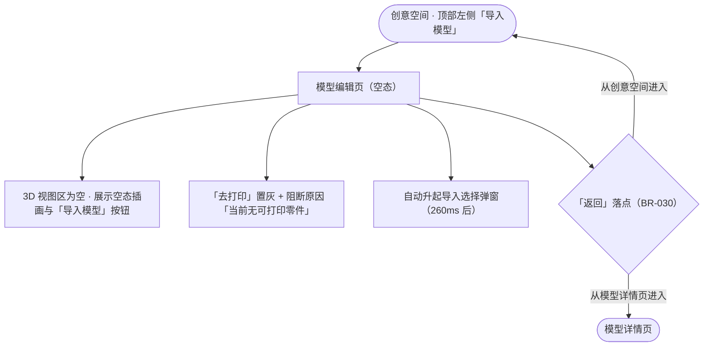

#### 2. 规则描述

- **触发条件**：用户在**创意空间**顶部左侧点击「导入模型」。
- **交互反馈**：
  - 先进入**模型编辑页空态**（3D 视图区**保留展示、但展示区为空**，见下），底部给出引导文案 + 「导入模型」按钮。
  - 随后**自动升起**导入选择弹窗（DEC-032），无需用户再点一次。
  - 空态下「去打印」**置灰**，按钮上方显示阻断原因「当前无可打印零件」（BR-008）。
  - 空态下**不展示**左上角「添加」按钮与盘号区。
  - 编辑页标题显示为「新的打印任务 · 空」。
- **空态保留 3D 展示区（BR-039 / DEC-047 / DEC-054）**：
  - 3D 视图区**照常渲染**打印空间示意框（180×180×180）与平台网格，**只是没有任何零件**——不把整块区域盖成一张图。
  - 空态提示**只有两件东西**：引导文案「从「我的 AI 创作」「我的切片」选择，或导入手机里的本地模型」+「导入模型」按钮。**不放**「还没有模型」标题，**不放**装饰插画 / 矩形框。
  - 提示内容**沉底**贴在 3D 展示区底部，**不占据页面中央**，把整块 3D 空间让给用户看。
  - 空态层**透明覆盖**、`pointer-events: none`（用户仍可拖动旋转这个空的空间）。
  - ⚠️ **实现约束 1**：进入空态必须**显式清空零件网格**（`buildPlateMeshes(null)`）。3D 场景不是响应式的——只改数据不清网格，会残留上一次渲染的模型（`LL-010`）。
  - ⚠️ **实现约束 2**：父层设了 `pointer-events: none`，**子按钮必须显式恢复 `pointer-events: auto`**，否则按钮「看得见点不动」（真实点击穿透到 canvas）。**注意程序化 `el.click()` 查不出这个问题**——验收必须用真实坐标点击 + `elementFromPoint` 命中测试（见 `LL-019`）。
- **返回落点（BR-030 / DEC-038）**：
  - 入口 = 创意空间 → 「返回」**回创意空间**（空态与导入完成后**均为**回创意空间）。
  - 入口 = 模型详情页「打印设置」→ 「返回」回模型详情页（`DEC-006` 不变）。
  - 「返回」**不做**退出确认弹窗，编辑结果默认保留（沿用 `BR-016`）。
- **异常处理**：创意空间的 `创意空间.png` 采用整图复用 + 透明热区（DEC-018），热区覆盖整张「导入模型」卡片，点击区域足够大，避免误触「自由创作」。

#### 3. 原型演示

[👉 查看交互原型 - 创意空间入口](../prototype/prototype_v1.0.html#creative-space)｜[👉 编辑页空态](../prototype/prototype_v1.0.html#import-empty-editor)

---

### 5.2 导入选择弹窗（M2）

#### 1. 交互流程图

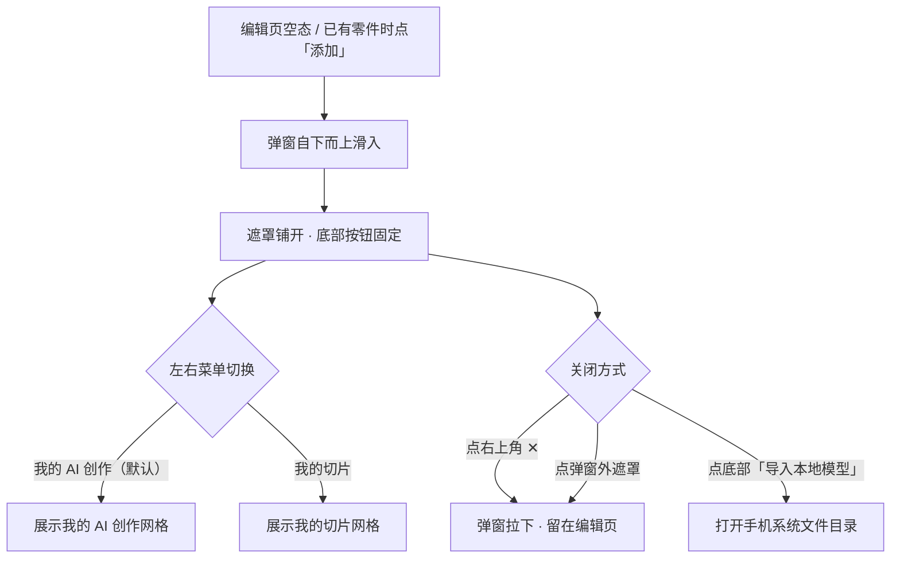

#### 2. 规则描述

- **触发条件**：编辑页空态自动升起；或编辑页已有零件时点左上角「添加」。
- **交互反馈**：
  - 弹窗**自下而上**滑入（`transform` 过渡，曲线与缩放面板一致）。
  - **高度明显高于缩放面板**（缩放面板约 470px，本弹窗 640px），因此能看到更多网格行；由于高度较高，空态 3D 区域会被遮住，关闭弹窗即可看到（见 §5.1 空态原型）。
  - 左右菜单为**两项 Tab**（左「我的 AI 创作」/ 右「我的切片」），默认停在**我的 AI 创作**，选中项下方有品牌色指示条。
  - 页面主体为**两排多列**网格（375px 宽度下 3 列），超出可纵向滚动。
  - 底部「导入本地模型」按钮**固定**——**不随左右菜单切换而改变**，始终可见可点。
  - 底部按钮上方有一行说明文案，交代两个菜单的数据来源。
- **关闭方式（两种）**：点右上角 `✕`；点弹窗外遮罩。二者行为一致：拉下弹窗、**留在模型编辑页**，不清空已导入内容。
- **异常处理**：列表为空时展示各自空态文案，底部「导入本地模型」**保持可用**（不让用户走进死胡同）。

#### 3. 原型演示

[👉 查看交互原型 - 导入选择弹窗（我的 AI 创作）](../prototype/prototype_v1.0.html#import-sheet)｜[👉 我的切片](../prototype/prototype_v1.0.html#import-sheet/slice)

---

### 5.3 我的 AI 创作（M3）

#### 1. 交互流程图

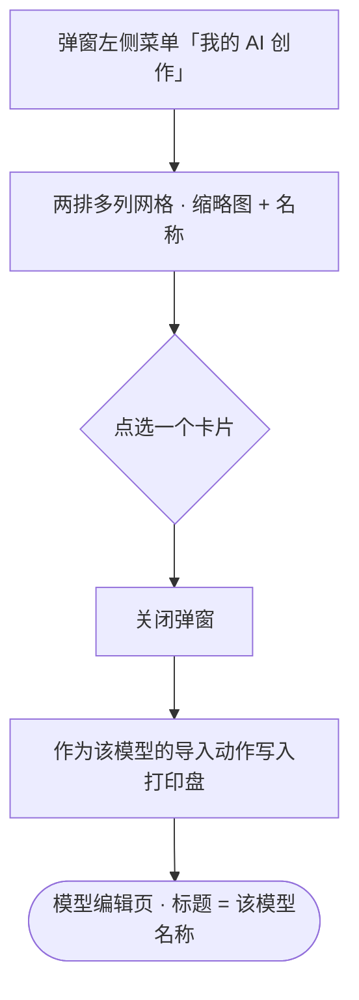

#### 2. 规则描述

- **数据来源**：「我的」页面中保存的 **AI 创作记录**（BR-059 / DEC-030）。
- **别名清理**：原「我的模型」一律改称「我的 AI 创作」（`GL-027`），「模型」一词只指整个三维模型文件。
- **卡片字段**：**仅「缩略图 + 名称」两项**（BR-029 / DEC-033）。不展示时间、文件大小、盘数、预计打印时间等其他字段。
- **缩略图**：**由服务端后台提供**，客户端不做 3D 首帧截图。
- **点选行为**：**点选一个模型即直接作为该模型的导入动作进入编辑页**（BR-028 / DEC-034）；**不与本地文件混合多选**，因此弹窗中不出现「导入 N 项」这类计数。
- **异常处理**：列表为空时展示「还没有 AI 创作内容，去创作或导入本地模型吧」（**AI推断·待确认**）。

#### 3. 原型演示

[👉 查看交互原型 - 我的 AI 创作](../prototype/prototype_v1.0.html#import-sheet)

---

### 5.4 我的切片（M4）

#### 1. 交互流程图

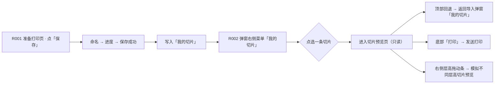

#### 2. 规则描述

- **数据来源**：「我的」页面中保存的**切片记录**，其**写入方**为 R001 准备打印页的「保存切片」链路（`DEC-024` / `BR-020`）。
- **跨需求说明**：R001 当时判定「我的 - 我的切片」页**本期不实现**（`GL-026` 原状态）；**R002 正式落地该页**（DEC-031）。即 **R001 负责"写"，R002 负责"读与展示"**。
- **展示方式**：与「我的 AI 创作」**完全同构**（两排多列网格，缩略图 + 名称，BR-029）。
- **点选行为**：点选一条切片 → **进入切片预览页**（不再导入、不进入模型编辑页；切片已携带原有的分盘与布局，预览页直接呈现该结果）。
- **异常处理**：列表为空时展示「还没有保存的切片，在「准备打印页」点「保存」即可留在这里」（**AI推断·待确认**）。

#### 3. 原型演示

[👉 查看交互原型 - 我的切片](../prototype/prototype_v1.0.html#import-sheet/slice)

---

### 5.4.1 切片预览页（M4-1）

#### 1. 交互流程图

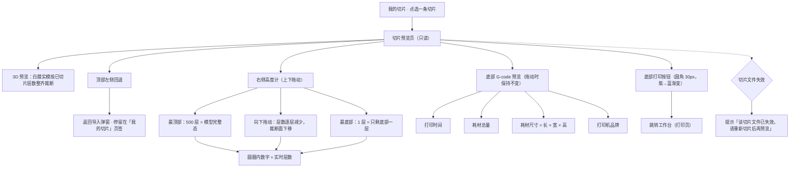

#### 2. 规则描述

- **页面性质**：**只读预览页，不可编辑**。不出现缩放 / 复制 / 删除工具栏，不出现「去打印」，无模型选中框；3D 区**仅支持旋转与缩放视角**，不可选中零件、不可变换。
- **进入方式**：导入选择弹窗「我的切片」中**点选一条切片即进入本页**，不经过导入流程、不进入模型编辑页。
- **顶部操作**：左侧**回退图标按钮**，点击返回导入选择弹窗并**停留在「我的切片」页签**（保留来源上下文，不让用户重新查找）。
- **3D 预览区**：沿用模型编辑页的 3D 展示区语言（打印平台 + 网格 + 切片包围盒）。切片本体**按当前已切片高度整齐裁断** —— 裁断面即真实的打印截面；表面按层做**深浅交替 + 层缝压深**处理，使「一层层累加」在视觉上可辨；**最上一层用品牌色高亮**，示意「当前正在切片的一层」。模型为**白膜实模**（111.6 × 105.4 × 96.8 mm）。
- **右侧高度计（可上下拖动，本页核心）**：用于**模拟切片在不同层高处已建成的模型状态**。切片文件本质由一层层累加而成，因此**拖动 = 沿 Z 轴逐层「打印」**：
  - **最顶部 = 500 层 = 模型完整态**；**向下拖动层数逐层减少**，裁断面随之下移。
  - **最底部 = 1 层 = 只剩底部第一层**，只显示底面轮廓。
  - 圆圈内数字 = **实时层数**（顶部 500，底部 1），随拖动即时变化。
  - 每层厚度 = 模型总高 ÷ 500 ≈ **0.194mm**（由切片层数反推，**非用户可调参数**）。
  - 键盘可达：`↑` 层数 +10，`↓` 层数 −10。
- **拖动的影响边界（关键规则）**：高度计**只改变 3D 预览中已建成的层数与裁断面**；**打印时间**与**耗材总量**是**整份切片**的固有属性，**拖动过程中保持不变**。同理**耗材尺寸**、**打印机品牌**亦不随拖动变化。
- **底部 G-code 预览**：四项只读摘要 —— **打印时间**、**耗材总量**、**耗材尺寸（长 × 宽 × 高）**、**打印机品牌名称**；四项**均为整份切片的常量**，不随高度计拖动变化。
- **G-code 卡下方不展示任何引导说明文案**（当前切片到第几层等信息一律不上屏），层数信息只保留在 3D 区左上角 HUD 与右侧高度计圆圈内。
- **底部打印按钮**：整宽主按钮，**圆角 30px**，**从左向右紫色到蓝色渐变**。切片已是生成好的 gcode，点击「打印」= **发送打印**，**跳转至工作台（打印页）**。
- **异常处理**：切片记录失效 / gcode 文件丢失时，提示「该切片文件已失效，请重新切片后再预览」并提供返回入口（**AI推断·待确认**）；预览过程**不依赖实时网络**，允许离线查看。
- **G-code 数值口径**：当前原型由模型包围盒按实心率 42% 折算得出打印时间与耗材量（演示态）；接入切片引擎后应**以引擎返回的真实值为准**（**AI推断·待确认**）。

#### 3. 原型演示

[👉 查看交互原型 - 切片预览页](../prototype/prototype_v1.1.html#slice-preview)｜[👉 我的切片（点选进入预览页）](../prototype/prototype_v1.1.html#import-sheet/slice)

> ⚠️ 本页为 **v1.1 新增**，独立文件 `prototype_v1.1.*`；v1.0 原型（及其发布链接）保持不变，作为历史快照。

---

### 5.5 导入本地模型（M5）

#### 1. 交互流程图

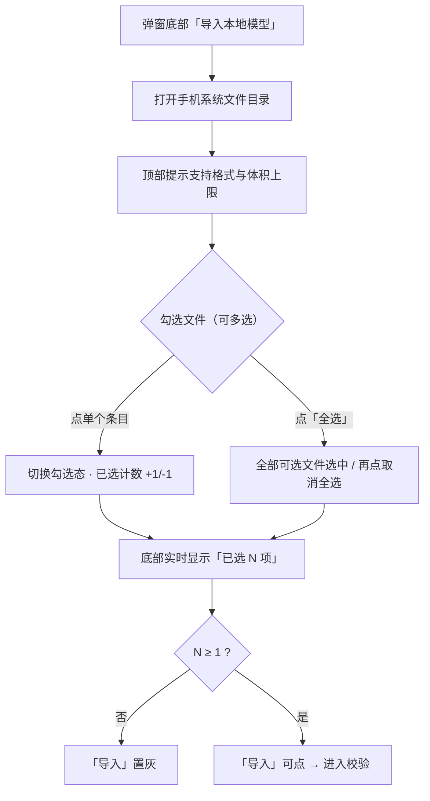

#### 2. 规则描述

- **触发条件**：点弹窗底部「导入本地模型」。
- **交互反馈**：
  - 打开**模拟的手机系统文件系统页面**（本原型为模拟页，正式产品调用系统文件选择器）。
  - 顶部提示条写明支持格式（stl / 3mf / obj / gcode / stp / zip）与单文件上限（100MB），并注明**多选规则：模型文件可多选，gcode / zip 仅可单独导入**（BR-063）。
  - **路径面包屑** + 按目录分组（Download / Documents）。
  - 每个条目展示：类型角标、文件名、大小、时间；超 100MB 的文件&#x5E26;**「超 100MB」红色角标**；**gcode 与 zip 条目&#x5E26;「仅可单独导入」标签**（BR-063）。
  - 底部固定操作条：左侧「已选 N 项」，右侧「导入」按钮（未选时置灰）。
  - **「全选」**&#x4E00;键勾选/取消全部可选文件。
  - 超过批量上限时，底部**实时给出提示**（如「单次总量上限 300MB，超出部分不会导入」）。
  - **多选时混入 gcode / zip**，底部**实时提示**「模型文件不可与 gcode / zip 一起导入」（BR-063；点「导入」后由格式及安全校验弹窗拦截，见 §5.6）。
- **异常处理**：
  - 未选择任何文件 → 「导入」置灰不可点。
  - 无文件访问权限 → 「需要访问文件权限才能导入模型」+「去设置」引导（**AI推断·待确认**）。
  - 多选文件中混合模型文件与 gcode / zip → 点「导入」后弹窗拦截，不进入上传步骤（BR-063，详见 §5.6）。

#### 3. 原型演示

[👉 查看交互原型 - 手机系统文件目录](../prototype/prototype_v1.0.html#system-picker)

---

### 5.6 格式与大小校验 + 自动优化（M6）

#### 1. 交互流程图

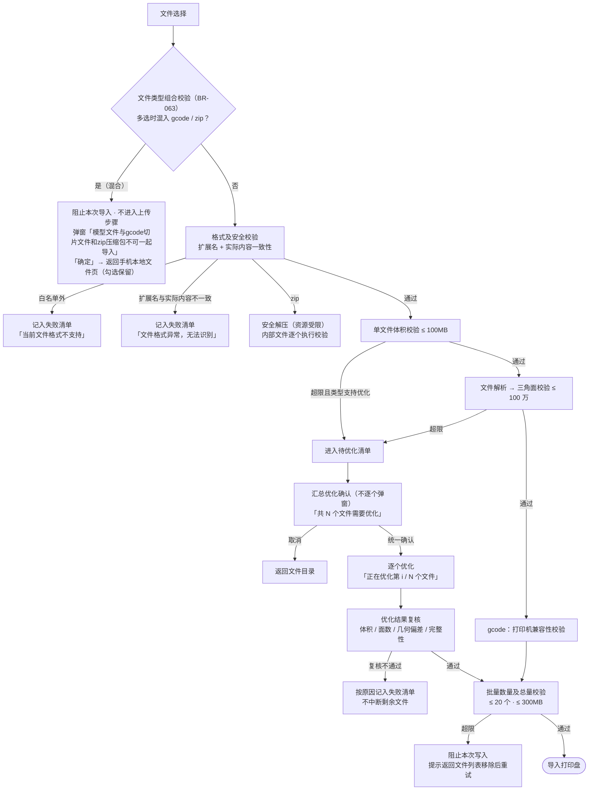

#### 2. 规则描述

**格式白名单**：`stl`、`3mf`、`obj`、`gcode`、`stp/step`、`zip`（6 类）。不在列表内 → 「当前文件格式不支持」。

**格式校验**：同时校验文件扩展名和文件实际内容，防止文件扩展名与实际格式不一致。

**文件类型区分**：

- 模型文件：stl、3mf、obj、stp/step，支持模型解析、预览及符合条件的自动优化。
- 打印指令文件：gcode，不参与三角面数量校验及有损压缩，导入后进行打印机兼容性校验。
- 压缩包文件：zip，解压后对内部文件逐个执行格式、大小及复杂度校验。

**文件类型组合校验（BR-063 / DEC-074）**：

| 文件分组 | 格式 | 多选规则 |
| --- | --- | --- |
| 模型文件 | stl / 3mf / obj / stp(step) | **支持多选**上传（多文件自动分盘，见 §5.7） |
| 打印指令文件 | gcode | **只能单独上传** |
| 压缩包文件 | zip | **只能单独上传** |

- **判定时机**：点「导入」后的**格式及安全校验阶段首先执行**（先于扩展名 / 实际内容校验）；命中即**阻止本次导入，不进入上传步骤**。
- **混合场景**：多选时出现任一 gcode 或 zip 即命中，包括「模型文件 + gcode」「模型文件 + zip」「gcode + zip」「多个 gcode」「多个 zip」。
- **拦截弹窗**（单一主按钮，不做二次选择）：
  - 标题：「无法一起导入」
  - 内容：「模型文件与gcode切片文件和zip压缩包不可一起导入。」
  - 辅助说明：「模型文件（stl / 3mf / obj / stp）可多选导入；gcode 与 zip 需单独导入。」
  - 按钮：「**确定**」。
- **点「确定」→ 返回手机本地文件页**（已选文件保留，用户可自行移除后重试，与批量超限的处理口径一致）。
- 文件目录在勾选阶段即给出引导：gcode / zip 条目带「仅可单独导入」标签，混合勾选时底部实时提示「模型文件不可与 gcode / zip 一起导入」（见 §5.5）。
- 单独上传 gcode 的后续落点：导入后自动跳转**切片预览页**（见 §5.7）。

**三层闸门（BR-021 / DEC-027）**：

|  层  | 限制                     | 判定时机                      |
| :-: | ---------------------- | ------------------------- |
|  ①  | 单文件 ≤100MB             | 选择文件后立即校验；允许优化的文件在优化后重新校验 |
|  ②  | 单模型三角面 ≤100万面          | 模型解析后校验；超过限制则尝试简化并重新校验    |
|  ③  | 单次 ≤20个有效文件，且总量 ≤300MB | 所有文件完成校验及优化后、写入打印盘前       |

**数值定义**：

- 文件大小统一使用十进制MB：1MB = 1,000,000 Bytes。
- 100MB为单文件导入体积限制，不代表打印机的最大切片能力。
- 100万面为模型解析后用于预览、编辑的单模型工作网格上限。
- 20个文件指单次导入的有效文件数量，ZIP按解压后的有效文件数量统计；一个3MF仍计为一个文件，其内部模型对象另行统计。
- 300MB按完成必要转换及优化后的有效导入文件大小总和计算。
- 上述数值为初始业务阈值，需通过目标手机及打印机上位机性能测试验证。

**校验顺序（实现约定）**：

> 文件选择 → **文件类型组合校验（BR-063）** → 格式及安全校验 → 单文件体积校验 → 文件解析 → 三角面校验 → 必要的自动优化 → 优化结果复核 → 批量数量及总量校验 → 导入打印盘

- 文件超过100MB时，优先判断是否支持自动优化，不直接丢弃。
- 文件未超过100MB但三角面超过100万面时，仍需触发网格简化。
- 文件优化完成后，必须重新校验文件大小、三角面数量及模型完整性。
- 所有有效文件完成单文件校验后，再判断批量总量，避免批量闸门提前阻断自动优化。
- ⚠️ **顺序要求**：不得在单文件自动优化前执行300MB总量拦截，否则可能导致原本可以通过优化成功导入的文件被提前拒绝。文件解析过程中仍须设置独立的内存和资源保护限制。

**自动压缩策略（BR-022）**

触发条件：

- 单文件超过100MB，且文件类型支持优化。
- 模型解析后三角面超过100万面。
- 文件符合大小限制，但用户主动选择优化模型（可选功能，V1可暂不支持）。

优化原则：

- 优先采用无损转换或无损压缩。
- 无损优化无法满足限制时，在用户确认后执行有损网格简化。
- 有损优化必须控制模型几何偏差，不得仅以文件体积达标作为成功条件。
- 不得默认删除影响模型打印结果的必要数据，如颜色、材料映射和模型结构。
- 原始文件不覆盖，优化结果生成独立工作文件。

| 文件类型     | 自动压缩/优化策略                        | 关键参数                     | 处理说明                          |
| -------- | -------------------------------- | ------------------------ | ----------------------------- |
| stl      | ASCII格式优先转换为Binary STL；必要时执行网格简化 | 几何偏差建议≤0.05mm；目标≤100万面   | 二进制转换为无损表示转换；网格简化为有损处理        |
| obj      | 执行网格简化，优化冗余几何数据                  | 几何偏差建议≤0.05mm；目标≤100万面   | 默认保留材质及纹理引用；确需移除时须用户确认        |
| 3mf      | 优先无损重打包；仍超限时执行网格简化               | 几何偏差建议≤0.05mm；目标≤100万面   | 保留必要的颜色、材质及对象关系               |
| gcode    | 不执行有损压缩；仅支持经兼容性验证的无损压缩或编码        | 不修改坐标精度、挤出量及运动指令         | 不适用三角面校验；超限且无法无损处理则导入失败       |
| stp/step | 将CAD曲面离散化为三角网格                   | 默认弦高公差0.05mm；必要时尝试0.10mm | 转换后校验文件体积、面数和几何偏差；不直接修改原始STEP |
| zip      | 安全解压后，对内部文件分别执行对应格式策略            | 解压总量建议≤300MB；有效文件≤20个    | ZIP本身不执行几何简化，需校验内部文件及解压资源消耗   |

> ⚠️ **数值说明**：0.05mm、0.10mm为V1建议的初始工程参数，并非行业统一标准。实际参数应结合打印精度、模型细节及目标设备性能测试确定。

**网格简化约束**：

- 简化后单模型三角面数量≤100万面。
- 默认最大几何偏差建议≤0.05mm。
- 应尽可能保留模型边界、孔洞、薄壁及连接结构。
- 模型体积变化率建议≤1%，作为异常检测辅助指标，不作为唯一成功条件。
- 若模型无法在允许几何偏差内满足大小或面数要求，则优化失败。
- 不得通过无限增加几何公差的方式强制压缩成功。

**超限交互（BR-023）**

- 单文件超过100MB：
  - 如果支持自动优化，弹出确认弹窗：
    - 标题：「文件超过100MB」
    - 内容：「当前文件：（文件名+大小）。可尝试自动优化后导入，优化可能导致模型部分细节发生变化。」
    - 展示优化策略：如「转换为二进制格式」「减少三角面数量」。
    - 按钮：「取消」「自动优化」。
  - 如果不支持自动优化：提示「文件过大，暂不支持自动优化，请重新选择模型。」
- 三角面数量超过100万面：
  - 标题：「模型结构过于复杂」
  - 内容：「当前模型包含X个三角面，超过100万个三角面的导入限制。可尝试简化模型，但可能损失部分细节。」
  - 按钮：「取消」「简化模型」。
- 多文件超限：
  - 不连续弹出多个确认弹窗。
  - 汇总所有需要优化的文件，展示：「共N个文件需要优化」+ 各文件名称、大小及触发原因 + 优化可能造成的细节变化说明。
  - 用户统一确认后依次处理。
  - 处理进度展示：「正在优化第i/N个文件」。
  - 每个文件独立记录成功或失败结果，不因单个文件失败中断剩余文件处理。

**压缩结果校验（BR-024）**

| 校验项   | 成功条件                  |
| ----- | --------------------- |
| 文件体积  | 优化后单文件≤100MB          |
| 三角面数量 | 适用的模型工作网格≤100万面       |
| 几何偏差  | 不超过配置的最大允许偏差          |
| 文件完整性 | 文件可正常解析，必要的模型数据完整     |
| 模型结构  | 不存在优化过程新增的严重结构错误      |
| 兼容性   | 处理结果可被当前模型预览及后续切片链路支持 |

- gcode不执行三角面及几何偏差校验。
- stp/step以离散化后生成的工作网格执行面数校验。
- 多对象3mf以参与当前导入的模型工作网格总面数进行校验，不能仅判断其中单个对象。
- 优化成功后，使用优化文件继续执行批量校验。
- 优化失败后，不将失败文件写入打印盘，原始文件保持不变。

**ZIP文件处理规则（BR-025）**

- ZIP作为文件容器处理，不直接作为模型对象导入。
- 解压后仅允许包含白名单内可处理的有效文件。
- 解压后按实际文件数量及体积执行校验。
- 建议设置以下初始限制：

| 校验项        | 限制                   |
| ---------- | -------------------- |
| 解压后文件总量    | ≤300MB               |
| 单个解压文件     | ≤100MB；可优化文件允许先优化再判定 |
| 单次有效文件数量   | ≤20个                 |
| ZIP压缩比异常筛查 | 建议100:1作为初始阈值        |
| 嵌套ZIP      | V1不支持                |
| 路径穿越及恶意文件  | 拦截                   |

- ZIP解压过程中必须限制实际累计解压字节数及资源占用，不得仅依据压缩包元数据判断是否安全。
- 若压缩包触发安全或资源限制，则停止解压并提示文件异常。
- 对于已安全解压的部分文件，如其中存在格式不支持、模型损坏或优化失败的情况，可按多文件部分成功规则处理。

**批量导入及异常处理（BR-026）**

批量校验规则：

- 所有文件完成独立校验及优化后，统计有效文件数量和总大小。
- 有效文件数量≤20，且总量≤300MB，允许继续导入。
- 超出限制时，不自动删除文件或擅自选择导入部分文件。
- 展示超限原因，允许用户返回文件列表进行移除后重试。

异常处理：

| 异常场景             | 处理策略           | 提示文案                 |
| ---------------- | -------------- | -------------------- |
| 格式不支持            | 跳过当前文件         | 当前文件格式不支持            |
| 文件内容与格式不一致       | 拒绝导入           | 文件格式异常，无法识别          |
| 多选混合模型文件与 gcode / zip | 阻止本次导入（不进入上传步骤） | 模型文件与gcode切片文件和zip压缩包不可一起导入 |
| 单文件超过100MB且不支持优化 | 拒绝当前文件         | 文件过大，无法继续导入          |
| 自动优化失败           | 当前文件标记失败       | 模型优化失败，请尝试其他模型       |
| 优化后仍超过100MB      | 当前文件标记失败       | 文件过大，无法继续导入          |
| 优化后仍超过100万面      | 当前文件标记失败       | 模型结构过于复杂，无法继续导入      |
| 优化导致几何偏差超限       | 当前文件标记失败       | 模型优化可能影响打印效果，无法继续导入  |
| 模型解析失败           | 当前文件标记失败       | 模型文件异常，无法解析          |
| G-code不兼容        | 当前文件标记失败       | 当前打印文件与打印机不兼容        |
| ZIP解压异常或触发安全限制   | 终止该压缩包处理       | 压缩包异常，无法安全解压         |
| 批量文件数超过20个       | 阻止本次写入         | 单次最多导入20个文件，请移除部分文件  |
| 批量总量超过300MB      | 阻止本次写入         | 文件总大小超过300MB，请移除部分文件 |
| 多文件部分失败          | 保留通过校验的文件，继续处理 | 已成功处理X个文件，Y个文件导入失败   |

- 单文件场景：使用专门的异常提示弹窗，失败后返回文件选择或导入前页面。
- 多文件场景：失败文件加入失败清单，继续处理其他文件，不整体回滚。
- 部分成功场景：展示成功数量及失败清单，允许用户查看失败原因；只有通过所有校验的文件才能写入打印盘。
- 取消处理：停止未开始的优化任务，清理临时文件；已经完成校验的文件可保留在本次待导入列表中，由用户决定是否继续。
- 写入失败：若写入打印盘过程中发生异常，应清理未完成的对象，避免生成不完整或重复的模型。

**技术实现约定**

- APP端：负责文件选择、扩展名及基础格式识别、文件大小初检、用户确认、任务进度和结果展示。
- 模型处理模块：负责模型解析、三角面统计、网格简化、STEP离散化、文件优化以及几何完整性复核。
- 打印机上位机：负责最终模型或G-code兼容性校验，以及后续切片和打印处理。
- 服务端（如参与文件传输或模型优化）：负责上传限制、任务资源限制、文件完整性校验及临时文件清理。
- 性能要求：100MB、100万面、20个文件、300MB为V1初始配置值，应支持后续根据测试结果调整，不建议硬编码在多个客户端及服务端模块中。

> **验收重点**：不仅验证文件是否符合大小和面数限制，还需验证导入耗时、峰值内存、模型预览流畅度、模型几何保真、上位机切片成功率，以及多文件部分失败后的数据一致性。

#### 3. 原型演示

[👉 格式不支持](../prototype/prototype_v1.0.html#format-unsupported)｜[👉 优化确认（超100MB）](../prototype/prototype_v1.0.html#compress-dialog)｜[👉 优化中（第 i / N 个）](../prototype/prototype_v1.0.html#optimize-progress)｜[👉 优化后仍过大](../prototype/prototype_v1.0.html#too-large)｜[👉 批量总量超限阻断](../prototype/prototype_v1.0.html#batch-limit)｜[👉 混合导入拦截（模型+gcode/zip，v1.1）](../prototype/prototype_v1.1.html#mixed-type-block)

> 原型演示说明：模型解析、网格简化和几何偏差计算在原型中以模拟数据表达（体积按约 42% 折算、面数同比例缩减），用于演示交互链路与文案口径；真实优化由模型处理模块实现。

---

### 5.7 导入执行与自动分盘（M7）

#### 1. 交互流程图

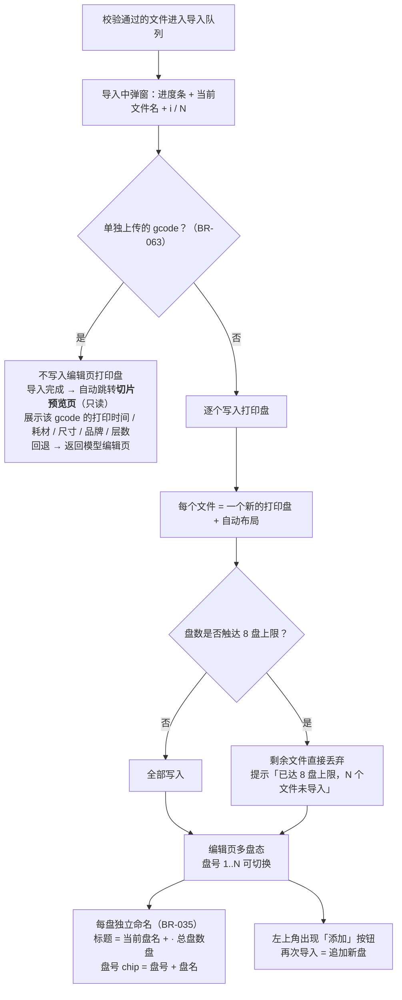

#### 2. 规则描述

- **导入过程**：弹窗式进度条 + 百分比 + **当前正在导入的文件名** + 「i / N」进度。多文件时**必须给出进度**，避免用户面对长时间静默等待（对应原需求 §2.3「需注意上传速率以及结果反馈效果」）。单独上传 gcode 时进度标题为「正在导入切片文件…」。
- **单独上传 gcode → 切片预览页（BR-063 / DEC-074）**：
  - 单次仅导入 **1 个 gcode 文件**时，**不写入编辑页打印盘**；导入完成后**自动跳转切片预览页**（只读，不可编辑，页面能力见 §5.4.1）。
  - 切片预览页展示该 gcode 自带的切片数据：**打印时间 / 耗材总量 / 耗材尺寸（长×宽×高）/ 打印机品牌**；层数与右侧高度计按该 gcode 的层数呈现（顶部 = 完整态，底部 = 1 层）。
  - 预览页「打印」按钮 = 发送打印，落点仍为工作台（打印页原型，DEC-073）。
  - 预览页回退 → 返回**模型编辑页**（不重开导入弹窗；空态入口「导入模型」就在编辑页）。
  - gcode 切片数据在原型中为**演示值（AI拟定·待确认）**，正式产品由 gcode 解析 / 服务端返回真实值。
- **自动分盘**：多选导入后**自动进行分盘与自动布局**；每个文件落在**独立的新打印盘**上。
- **追加新盘（BR-031 / DEC-039）**：编辑页**已有零件时再次导入 → 追加为新的打印盘**，不覆盖、不重置现有任务。
- **每盘独立命名（BR-035 / DEC-043）**：
  - 每个打印盘带**自己的盘名**，多文件导入时各盘取**各自来源文件的文件名（不含扩展名）**。
  - **编辑页标题**显示**当前盘的盘名** + `· 总盘数盘` —— 切换盘时标题随之变化。
  - **盘号 chip** 显示「**盘号 + 盘名**」（盘名超长省略，`title` 给全称），一眼看出"哪盘是哪个模型"。
  - **准备打印页**每行显示「**盘名 · 盘N**」。
  - 「我的切片」导入时，盘名取该切片的保存名。
  -
- **盘数上限（BR-060 / DEC-035）**：分盘数**最多 8 盘**（`GL-001` / `BR-009`）；触达上限后**剩余文件直接丢弃并提示**，「已达 8 盘上限，N 个文件未导入」。**不合并进第 8 盘**，**不生成第 9 盘**。
- **异常处理**：传输中断/失败 → 见 §5.8。

#### 3. 原型演示

[👉 导入中](../prototype/prototype_v1.0.html#import-progress)｜[👉 多选导入 → 8 盘上限溢出](../prototype/prototype_v1.0.html#import-multi-result)｜[👉 单独上传 gcode → 切片预览页（v1.1）](../prototype/prototype_v1.1.html#gcode-import)

---

### 5.8 结果反馈与异常（M8）

#### 1. 交互流程图

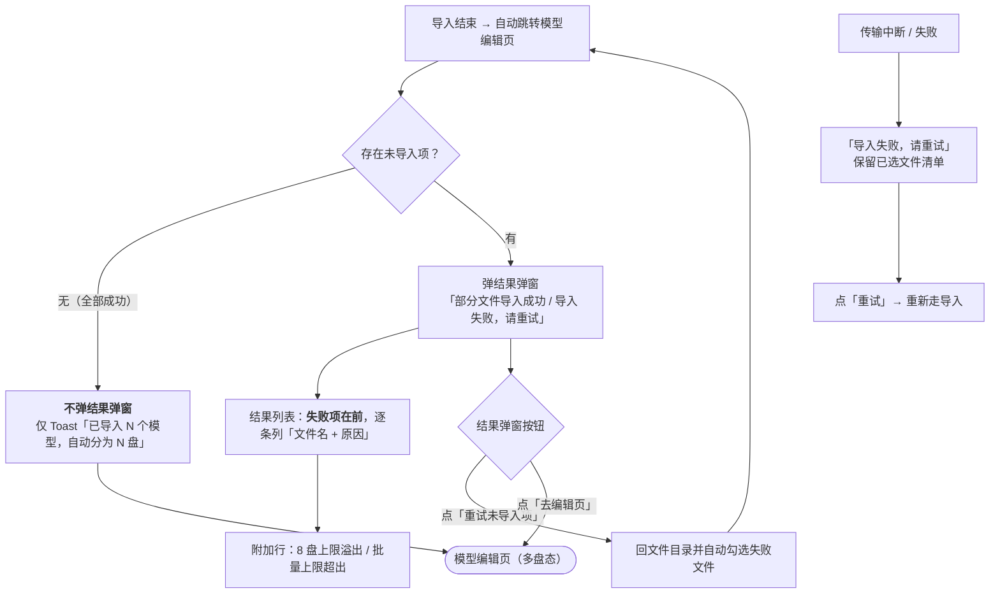

#### 2. 规则描述

- **部分成功策略（BR-058 / DEC-029）**：一次多选 N 个文件时，**校验通过的文件正常导入并自动分盘**；**失败的文件不阻断其他文件**，在结果提示中**逐条列出「文件名 + 失败原因」**。**不整体回滚**。
- **全部成功不弹窗（BR-036 / DEC-044）**：
  - 导入完成后**自动跳转至模型编辑页**，**不弹「导入完成」弹窗**——理想路径不该多一步确认。
  - 全部成功时仅用 **Toast** 提示「已导入 N 个模型，自动分为 N 盘」。
  - **仅当存在未导入项**（格式不支持 / 超限 / 8 盘溢出 / 批量超限）时才弹结果弹窗。
- **结果弹窗结构**：
  - 图标 + 标题按结果切换（! 部分成功 / × 全部失败）。
  - 描述行给出「成功 N 个 · 未导入 M 个」。
  - **列表区失败项优先展示**（最重要信息不被折叠到滚动区下方），失败行带具体原因（如「当前文件格式不支持」「文件过大，无法继续导入」）。
  - 溢出与批量上限也作为独立失败行列出。
  - **按钮（刻意做成非冗余）**：「**重试未导入项**」（次要）+「**去编辑页**」（主要）。
- **重试未导入项**：关闭弹窗 → 回到手机系统文件目录，并**自动勾选上次失败的文件**（附 Toast「已回填 N 个未导入的文件，可重新选择」）。用户无需在目录里重新找一遍，直接再点「导入」即可。
- **上传失败（传输层）**：文案「导入失败，请重试」；**保留已选文件清单**，点「重试」重新走一遍导入，用户不必重新选文件。
- **原型要求**：失败态在真实操作路径中不易自然出现，因此**在演示控制台提供一键触发开关**（沿用 R001 `DEC-003` 的做法）。

#### 3. 原型演示

[👉 部分成功结果](../prototype/prototype_v1.0.html#partial-result)｜[👉 导入失败](../prototype/prototype_v1.0.html#import-failed)

---

### 5.9 无网环境导入（M9）

#### 1. 交互流程图

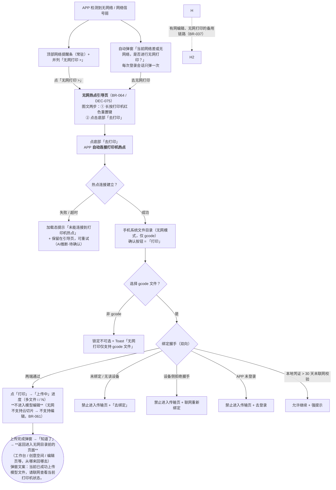

#### 2. 规则描述

- **感知与入口（BR-027 / DEC-037）**：
  - 检测到**无网络或网络信号弱**时，APP 顶部展示**网络提醒条（常驻）**，并**并列**提供「无网打印 >」跳转按钮。
  - 同时**自动弹出**弹窗「当前网络差或无网络，是否进行无网打印？」，**每次登录会话只弹一次**（避免每次打开 APP 都打扰）。
  - **两个入口点击后均进入「无网热点引导页」（BR-064），不再直接进入手机系统文件目录**——用户需要先建立热点连接，否则选中文件也无法传输。
  - **提醒条的显示范围**：常驻提醒条只在**链路外的页面**（工作台 / 创意空间 / 编辑页等）展示；进入**热点引导页**与**无网文件目录**后**不再叠提醒条**——这两页本身已自解释（引导页讲清了热点机制，文件目录标题与提示条已标明「无网打印 · 选择文件」），再叠一层属于重复提示。离开链路回到来源页后提醒条恢复。
- **无网热点引导页（BR-064 / DEC-075）**：
  - **技术方案**：无网打印通过**手机连接打印机热点**实现——热点连接建立后，手机与打印机处于同一局域网，APP 通过该通道把 **gcode 文件**传输给打印机，由打印机执行打印；全程不依赖公网。
  - **页面结构（图文并茂，两步指引）**：
    | 步骤 | 标题 | 说明 | 图示 |
    |:---:|------|------|------|
    | ① | **长按红色重置键** | 在打印机通电状态下，长按机身上的**红色重置键**约 3 秒 | 占位图：打印机红色重置键位置示意 |
    | ② | **点击底部「去打印」** | APP 会**自动连接打印机热点**，连接建立后自动打开文件目录 | 占位图：APP 自动连接打印机热点示意 |
  - 顶部以一句话说明技术方案：「手机连接**打印机热点**后，即可在局域网内把 gcode 文件直接传给打印机，无需公网」。
  - **图示当前为占位符**（虚线框 + 「占位图 ·xxx」标注），设计稿交付后替换为真实插画 / 截图。
  - 步骤 ① 中「红色重置键」以红色高亮块标记，便于用户快速在机身上定位。
- **底部「去打印」按钮（BR-064）**：
  - **整宽主按钮**，**圆角 30px**，**从左至右紫色 → 蓝色渐变**（`#7B5CFF → #3E8BFF`，90deg），与切片预览页打印按钮视觉一致。
  - 按钮为**双行结构**：主文案「去打印」+ 副文案「自动连接打印机热点」。
- **自动连接热点 → 跳转文件目录（BR-064）**：
  - 点击「去打印」后，APP **自动发起打印机热点连接**，页面显示加载态（半透明遮罩 + 加载圈 +「正在连接打印机热点…」+「请确保打印机已开机并处于热点状态」）。
  - **连接建立后**，自动跳转**手机系统文件目录**（无网模式，仅 gcode，确认按钮 =「打印」）。
  - 引导页顶部返回按钮 `‹` → 返回**进入引导页之前所在的页面**（工作台 / 创意空间 / 编辑页等，**从哪来回哪去**）。
  - 文件目录返回 `‹` → 回到**热点引导页**（而非来源页），保证「引导 → 选文件」这一段链路可回溯。
  - **异常处理——热点连接失败 / 超时（BR-064）**：
    | 项 | 内容 |
    |---|---|
    | 触发 | 点「去打印」后 APP 发起热点连接，**连接失败或超时**（**超时阈值 AI拟定·待确认，建议 10s**） |
    | 落点 | **保留在引导页**，**不跳转**手机系统文件目录 |
    | 提示形态 | 加载圈切换为**红色警示图标**，主文案「**未能连接到打印机热点**」，辅助说明「请确认打印机已开机并处于热点状态，然后重试。」 |
    | 出路 | 弹盒内**整宽「重试」按钮**（圆角 22px，紫→蓝渐变，与页面主按钮同语言）；点击后**重新发起连接**，回到「正在连接打印机热点…」加载态 |
    | 再次失败 | 回到本失败态，可**无限重试**（不设次数上限） |
  - **加载态视觉**：连接中弹盒内为居中加载圈 +「正在连接打印机热点…」+「请确保打印机已开机并处于热点状态」；加载圈需**水平居中**（块级元素用 `margin: 0 auto`，`text-align:center` 对块级无效）。
- **范围限制（BR-057）**：
  - **仅支持 gcode**，文件 ≤ 100MB 均可支持。
  - 无网链路**不展示**「我的 AI 创作 / 我的切片」菜单（原因：那两个列表里的模型是 stl / 3mf 等非 gcode 格式，进去也选不了）。
  - 文件目录中**非 gcode 文件显示为锁定态**（虚线勾选框 + 「无网不支持」角标），点击给出 Toast 拦截。
- **无网直打（BR-061 / DEC-067）**：
  - 无网环境**不支持云切片**，因此也**不支持模型编辑**——无网文件目录的确认按钮&#x4E3A;**「打印」**（非「导入」）。
  - 选择 gcode（绑定握手通过）后**直接进入「上传中」进度**（多文件时显示「文件名（i / N）」逐个上传）→「上传完成」提示弹窗。
  - 点「知道了」→ **返回进入无网目录之前所在的页面**（工作台 / 创意空间 / 编辑页等，**从哪来回哪去**）。
  - 校验不通过的文件（如不兼容 gcode）跳过并 Toast 提示未上传数量，不阻断其余文件上传。
- **触发与连接方式**：用户在引导页按步骤 ① 长按红色重置键唤起打印机热点 → 按步骤 ② 点「去打印」，APP **自动连接打印机热点** → 连上后进入文件目录选 gcode → 走文件传输页。
- **绑定门禁（DEC-028）**：**无公网 ≠ 无通信**——打印机热点是局域网，APP 与打印机本地可达，因此判定必须在**本地**完成，不依赖云端。规则为「**本地凭证 + 双向握手**」：


  | 情形                       | 判定   | 是否允许进入传输页 |            提示与引导           |
  | ------------------------ | ---- | --------- | :------------------------: |
  | APP 本地有该设备 **且** 设备侧握手通过 | 已绑定  | ✅ 允许      |              —             |
  | 本地列表为空 / 无该设备 ID         | 未绑定  | ❌ **禁止**  | 「该打印机尚未与当前账号绑定」+「去绑定」（需联网） |
  | 本地有，但设备侧拒绝握手             | 凭证失效 | ❌ **禁止**  |    「打印机绑定信息已失效，请联网后重新绑定」   |
  | APP 未登录                  | 无主体  | ❌ **禁止**  |       「请先登录后再进行无网打印」       |
  | 本地凭证 > 30 天未联网校验         | 疑似过期 | ✅ 允许（强提示） |        「建议联网校验绑定状态」        |
  > **为什么必须双向**：只查 APP 本地列表会被「设备已解绑 / 换机」绕过；只查设备侧无法确认「是不是当前账号的」。故两端各校验一次。
- **文件传输页（BR-033 / DEC-041）**：**复用** `SM-005 任务上传弹窗` 的视觉与进度交互，仅把文案换成无网语境（「正在传输到打印机…」+ 已连接热点标识 + 进度条 + 「已传 / 总计」）；**不新建**功能重复的页面。
- **无网「去打印」= 上传中 → 上传完成（BR-037 / DEC-045）**（**备用链路**：适用于「有网时已编辑好模型、无网点打印」的场景；无网主链路见上方 BR-061 目录直打）：
  - 无网/弱网下，编辑页点「去打印」**不走云切片 Loading**（不显示「正在生成打印方案」六步流程）——无网本来就调不到云端切片，沿用它会误导用户。
  - 改为弹「**上传中**」进度弹窗：进度条 + 百分比 + **当前文件名**。
  - 上传完成后**自动跳转至打印页**（**该页本次不实现**），同时弹出提示弹窗，固定文案：
    > **上传完成**  
    > 当前已成功上传模型文件，请联网查看当前打印机状态。
- **准备打印页顶部无网标签（BR-038 / DEC-046）**：
  - 无网/弱网时，准备打印页顶部以**同色标签覆盖设计稿中烘焙的「准备打印」字样**，内容为「**无网打印**」+ 副标题「已通过局域网传输 · 联网后可查看打印机状态」。
  - **整页下移 8px** 并略微收窄（宽 370px），避免底部「保存 / 开始打印」被裁切。
  - 标签 `pointer-events: none`，**不遮挡返回热区**。
  - 该页**不再叠加全局网络提醒条**（避免两层提示 + 裁切整图页）。
- **异常处理**：热点连接失败 / 超时 → 保留在引导页并提示「未能连接到打印机热点」，允许重试（**AI推断·待确认**）；非 gcode → Toast；四种绑定拦截 → 禁止进入传输页（明确原因 + 下一步）。

#### 3. 原型演示

[👉 网络提醒条 + 自动弹窗](../prototype/prototype_v1.1.html#offline-dialog)｜[👉 **无网热点引导页（BR-064，两步图文 + 底部「去打印」）**](../prototype/prototype_v1.1.html#offline-guide)｜[👉 引导页 · 正在连接热点](../prototype/prototype_v1.1.html#offline-guide-connecting)｜[👉 无网文件目录（仅 gcode）](../prototype/prototype_v1.1.html#offline-picker)｜[👉 未绑定拦截](../prototype/prototype_v1.1.html#offline-unbound)｜[👉 凭证失效](../prototype/prototype_v1.1.html#offline-invalid)｜[👉 未登录](../prototype/prototype_v1.1.html#offline-guest)｜[👉 凭证超期](../prototype/prototype_v1.1.html#offline-expired)｜[👉 无网文件传输页](../prototype/prototype_v1.1.html#offline-transfer)｜[👉 上传中](../prototype/prototype_v1.1.html#upload-progress)｜[👉 上传完成](../prototype/prototype_v1.1.html#upload-done)｜[👉 准备打印页 + 无网标签](../prototype/prototype_v1.1.html#offline-prepare)

---

### 5.10 数据追踪与埋点（M10）

见第八章。埋点事件名与字段需与 R001 埋点规范对齐。

---

## 六、业务流程图

### 6.1 主链路：导入 → 校验 → 自动分盘 → 编辑页

> 高清原图：[`../flowcharts/main_flow.png`](../flowcharts/main_flow.png)｜Mermaid 源：[`main_flow.mmd`](../flowcharts/main_flow.mmd)
> **v1.1.3 更新**：图中补入「多文件混入拦截（BR-063）」异常节点与「切片预览页（只读 · DEC-074）」分支落点；离线链路 4 个拦截节点截图一并重拍（原为空白占位图）。

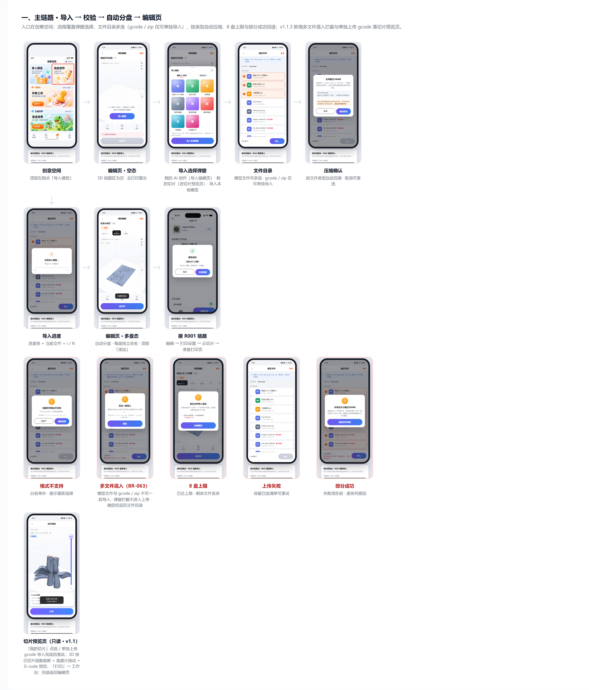

### 6.2 无网打印链路：网络提醒 → 绑定门禁 → 局域网传输

> 高清原图：[`../flowcharts/offline_flow.png`](../flowcharts/offline_flow.png)｜Mermaid 源：[`offline_flow.mmd`](../flowcharts/offline_flow.mmd)

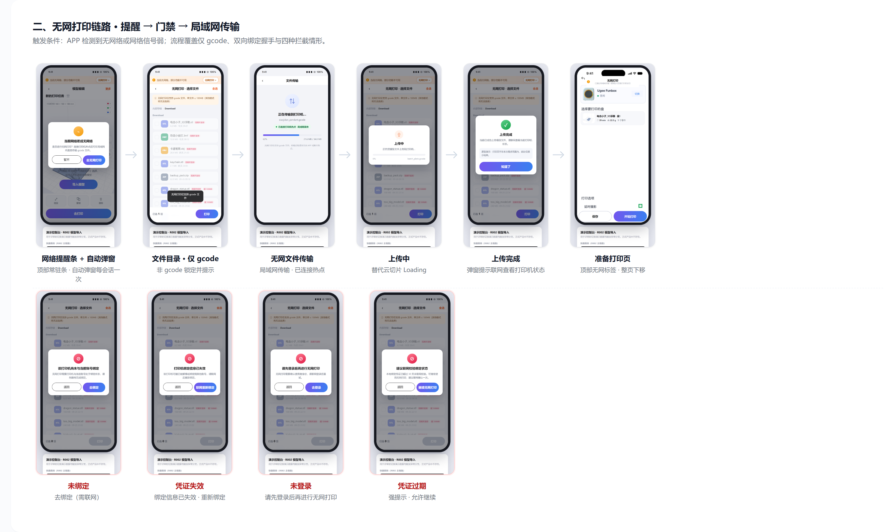

### 6.3 Mermaid 源（可直接渲染）

> 两张图的完整源文件见 `flowcharts/`，也可在浏览器打开 [`flows.html`](../flowcharts/flows.html) 查看（离线可渲染）。  
> 以下为**主链路核心主干**（省略部分异常分支，完整版见源文件）。

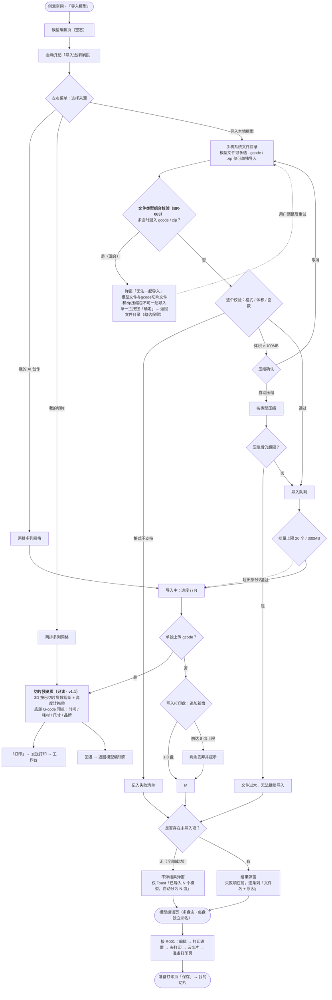

### 6.4 无网链路 Mermaid 源

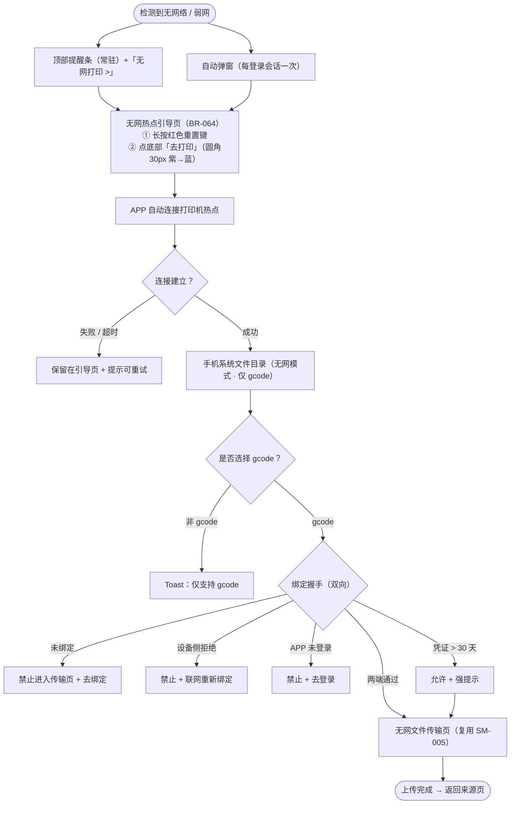

---

## 七、异常与边界处理

|  #  | 场景             | 触发条件                      | 提示文案                                               | 交互处理                              |
| :-: | -------------- | ------------------------- | -------------------------------------------------- | --------------------------------- |
|  1  | 格式不支持          | 选择的文件不在 6 类白名单内           | 「当前文件格式不支持」                                        | 跳过当前文件；多选时记入失败清单，不阻断其他文件          |
|  2  | 文件内容与格式不一致     | 扩展名与实际内容校验不符              | 「文件格式异常，无法识别」                                      | 拒绝导入；多选时记入失败清单                    |
|  2.5 | 多选混合模型文件与 gcode / zip | 多选时混入 gcode 或 zip（含 gcode+zip） | 「模型文件与gcode切片文件和zip压缩包不可一起导入」                        | **阻止本次导入，不进入上传步骤**；弹窗单一主按钮「确定」→ 返回手机本地文件页，勾选保留（BR-063） |
|  3  | 单文件超 100MB     | 体积 > 100MB 且类型支持优化        | 「文件超过100MB」+「可尝试自动优化后导入，优化可能导致模型部分细节发生变化。」         | 弹窗二选一：自动优化 / 取消（BR-023）           |
|  4  | 超 100MB 且不支持优化 | 体积 > 100MB 且类型不支持优化       | 「文件过大，暂不支持自动优化，请重新选择模型。」                           | 拒绝当前文件，返回文件选择                     |
|  5  | 三角面超限          | 模型解析后三角面 > 100 万          | 「模型结构过于复杂」+「可尝试简化模型，但可能损失部分细节。」                    | 弹窗二选一：简化模型 / 取消（BR-023）           |
|  6  | 优化失败           | 网格简化 / 无损处理未达到成功条件        | 「模型优化失败，请尝试其他模型」                                   | 当前文件标记失败，不中断剩余文件（BR-024）          |
|  7  | 优化后仍超限         | 优化后 > 100MB 或面数仍 > 100 万  | 「文件过大，无法继续导入」/「模型结构过于复杂，无法继续导入」                    | 当前文件标记失败，原始文件保持不变                 |
|  8  | 优化几何偏差超限       | 简化导致偏差超过允许值               | 「模型优化可能影响打印效果，无法继续导入」                              | 当前文件标记失败；不得无限增加公差强制成功             |
|  9  | 模型解析失败         | 文件无法解析                    | 「模型文件异常，无法解析」                                      | 当前文件标记失败，记入失败清单                   |
|  10 | G-code 不兼容     | 上位机兼容性校验不通过               | 「当前打印文件与打印机不兼容」                                    | 当前文件标记失败                          |
|  11 | ZIP 解压异常       | 触发安全限制 / 资源限制 / 压缩比异常     | 「压缩包异常，无法安全解压」                                     | 终止该压缩包处理；已安全解压部分按部分成功规则处理（BR-025） |
|  12 | 批量数量超限         | 有效文件 > 20 个               | 「单次最多导入20个文件，请移除部分文件」                              | **阻止本次写入**，返回文件列表移除后重试（BR-026）    |
|  13 | 批量总量超限         | 优化后总量 > 300MB             | 「文件总大小超过300MB，请移除部分文件」                             | **阻止本次写入**，返回文件列表移除后重试（BR-026）    |
|  14 | 部分文件失败         | 多选中部分文件校验不通过              | 「已成功处理X个文件，Y个文件导入失败」+ 逐条列「文件名 + 失败原因」              | **部分成功**：成功的进入编辑页并分盘（BR-058）      |
|  15 | 触达 8 盘上限       | 自动分盘后盘数 = 8，仍有剩余文件        | 「已达 8 盘上限，N 个文件未导入」                                | 剩余文件**直接丢弃**，已导入内容正常进入编辑页（BR-060） |
|  16 | 上传中断 / 失败      | 传输过程中断网、超时、服务异常           | 「导入失败，请重试」                                         | 保留已选文件清单，提供「重试」；已失败的文件不占用编辑页      |
|  17 | 存储权限未授予        | 无文件访问权限                   | 「需要访问文件权限才能导入模型」                                   | 提供「去设置」引导                         |
|  18 | 列表为空           | 「我的 AI 创作」无内容 / 「我的切片」无内容 | 「还没有 AI 创作内容，去创作或导入本地模型吧」/「还没有保存的切片」（**AI推断·待确认**） | 展示空态插画，底部「导入本地模型」按钮**保持可用**       |
|  19 | 无网 · 未绑定       | 本地已绑定列表无该设备               | 「该打印机尚未与当前账号绑定」                                    | **禁止进入传输页**，提供「去绑定」引导（需联网）        |
|  20 | 无网 · 凭证失效      | 设备侧拒绝握手（已解绑/已绑他号）         | 「打印机绑定信息已失效，请联网后重新绑定」                              | **禁止进入传输页**                       |
|  21 | 无网 · 未登录       | APP 未登录                   | 「请先登录后再进行无网打印」                                     | **禁止进入传输页**                       |
|  22 | 无网 · 凭证超期      | 本地凭证 > 30 天未联网校验          | 「建议联网校验绑定状态」                                       | **允许继续**（强提示，不硬拦）                 |
|  23 | 无网 · 选了非 gcode | 无网文件目录中选择了非 gcode 文件      | 「无网打印仅支持 gcode 文件」                                 | 该文件不导入                            |
|  24 | 无网 · 热点连接失败 / 超时 | 引导页点「去打印」后未能连上打印机热点 / 超时（阈值 **AI拟定·待确认**） | 「**未能连接到打印机热点**」+「请确认打印机已开机并处于热点状态，然后重试。」 | **保留在引导页**；加载圈换红色警示图标；弹**「重试」按钮**，点击重新发起连接，可无限重试 |

> 文案标注「**AI推断·待确认**」的条目为需求文档未给出文案、由 AI 按上下文补齐，需评审确认。

---

## 八、数据追踪与埋点

> 沿用 R001 DEC-015 的判定：本章必写。事件命名与字段需与 R001 埋点规范对齐。  
> ⚠️ 以下事件名与参数字段为 **AI 拟定 · 待确认**。

|  #  | 事件名                       | 触发时机         | 关键参数                                                                                                       | 支撑目标           |
| :-: | ------------------------- | ------------ | ---------------------------------------------------------------------------------------------------------- | -------------- |
|  1  | `import_entry_click`      | 点击创意空间「导入模型」 | `entry=creative_space`、`network_state=online/offline/weak`                                                 | 目标 1（分母）       |
|  2  | `import_sheet_view`       | 导入选择弹窗升起     | `default_tab=ai_creation`                                                                                  | 目标 1           |
|  3  | `import_source_select`    | 切换弹窗左右菜单     | `source=ai_creation/my_slice`                                                                              | 目标 1           |
|  4  | `import_picker_open`      | 打开手机系统文件目录   | `from=sheet/followup/offline`                                                                              | 目标 1、目标 2（分母）  |
|  5  | `import_file_selected`    | 文件选择完成       | `file_count`、`total_mb`、`is_multi=true/false`                                                              | 目标 2（分子）       |
|  6  | `import_validate_result`  | 校验完成（每个文件）   | `file_ext`、`size_mb`、`tri_count`、`result=pass/fail`、`fail_reason`                                          | 目标 1           |
|  7  | `import_compress_confirm` | 超限弹窗选择       | `choice=compress/cancel`、`file_ext`、`size_before`、`size_after`                                             | 目标 1           |
|  8  | `import_result`           | 导入流程结束       | `result=success/partial/failed`、`success_count`、`failed_count`、`plate_count`、`dropped_count`、`duration_ms` | 目标 1、目标 2、目标 3 |
|  9  | `import_finish_view`      | 进入模型编辑页      | `plate_count`、`part_count`、`source=local/ai_creation/my_slice/offline`                                     | 目标 3（终点）       |
|  10 | `offline_banner_view`     | 网络提醒条曝光      | `network_state=offline/weak`、`page`                                                                        | 目标 4           |
|  11 | `offline_dialog_action`   | 自动弹窗交互       | `action=go_offline_print/cancel`、`session_first=true`                                                      | 目标 4           |
|  12 | `offline_bind_check`      | 无网绑定握手结果     | `result=pass/unbound/credential_invalid/not_logged_in/expired`                                             | 目标 4           |
|  13 | `offline_transfer_result` | 无网文件传输结束     | `result=success/failed`、`size_mb`、`duration_ms`                                                            | 目标 4           |

**派生指标定义**

| 指标        | 计算方式                                                                                      |
| --------- | ----------------------------------------------------------------------------------------- |
| 导入成功率     | `import_result(result=success 或 partial 且有 success_count)` ÷ `import_file_selected` 的文件总数 |
| 多选平均成功文件数 | `AVG(import_result.success_count WHERE is_multi=true)`                                    |
| 导入→编辑页流失率 | 1 −（`import_finish_view` 去重会话数 ÷ `import_result(result≠failed)` 去重会话数）                    |
| 无网打印链路可用率 | `offline_transfer_result(result=success)` ÷ `offline_bind_check(result=pass)`             |

---

## 九、未来演进规划

| 版本   | 方向             | 说明                           |
| ---- | -------------- | ---------------------------- |
| v1.1 | 断点续传 / 后台续传    | 大文件传输中断后可续，本期为中断即重试          |
| v1.1 | 第三方来源导入        | 网盘（百度/阿里）、微信文件、云端分享链接直接导入    |
| v1.2 | 「我的 AI 创作」管理能力 | 重命名 / 删除 / 分组，本期只读           |
| v1.2 | 「我的切片」详情与管理    | 查看参数摘要、重新编辑、另存为、删除           |
| v1.3 | 导入历史与最近使用      | 记录最近导入的文件，一键重导               |
| v1.3 | 无网端侧切片         | 无网仅传输；后续评估端侧切片可行性，实现真正"断网可打" |
| v2.0 | 导入即推荐参数        | 基于模型几何特征在导入阶段预置打印参数与支撑策略     |

---

## 十、附件

### 附件 1：支持格式与三层限制（BR-021）

|  层  | 限制                                | 说明                                                      |
| :-: | --------------------------------- | ------------------------------------------------------- |
|  ①  | 单文件 ≤ **100MB**                   | 选择文件后立即校验；允许优化的文件在优化后重新校验；十进制 MB（1MB = 1,000,000 Bytes） |
|  ②  | 三角面 ≤ **100 万面**                  | **模型解析后**校验；超限尝试网格简化并重新校验（体积小但面数极高的文件会绕过体积闸门）           |
|  ③  | 单次 ≤ **20 个有效文件** 且总量 ≤ **300MB** | 所有文件完成校验及优化后、写入打印盘前判定；300MB 按优化后的有效文件总和计算               |

**格式白名单**：`stl`、`3mf`、`obj`、`gcode`、`stp`、`zip`（6 种）

> ②③ 的数值为 **AI 拟定 · 待确认**（DEC-027），需云切片实测后回填真实阈值。

### 附件 2：自动压缩策略（BR-022）

| 文件类型     | 压缩策略                         |                          |                                           |
| -------- | ---------------------------- | ------------------------ | ----------------------------------------- |
| 3mf      | 优先无损重打包；仍超限再网格简化             | 偏差 ≤0.05mm；目标 ≤100 万面    | 保留颜色、材质及对象关系                              |
| stl      | ASCII 优先转 Binary STL；必要时网格简化 | 偏差 ≤0.05mm；目标 ≤100 万面    | 二进制转换为无损；网格简化为有损                          |
| obj      | 网格简化，优化冗余几何数据                | 同上                       | 默认保留材质及纹理引用                               |
| gcode    | 不执行有损压缩；仅支持经验证的无损压缩或编码       | 不修改坐标精度、挤出量及运动指令         | 不适用三角面校验                                  |
| stp/step | CAD 曲面离散化为三角网格               | 默认弦高公差 0.05mm；必要时 0.10mm | 不直接修改原始 STEP                              |
| zip      | 安全解压后对内部文件分别执行对应策略           | 解压总量 ≤300MB；有效文件 ≤20 个   | ZIP 不执行几何简化；压缩比异常筛查建议 100:1；嵌套 ZIP V1 不支持 |

> 压缩为**有损转换**，压缩后仍需通过 ② 三角面校验；压缩后仍超限则终止导入。

### 附件 2.1：多选导入的文件类型组合限制（BR-063 / DEC-074）v1.1.3 新增

| 文件分组       | 格式                  | 多选规则           |
| ---------- | ------------------- | -------------- |
| 模型文件       | stl / 3mf / obj / stp | **支持多选**（多文件自动分盘） |
| 打印指令文件     | gcode                | **只能单独上传**      |
| 压缩包文件      | zip                  | **只能单独上传**      |

| 命中场景（多选时出现任一 gcode 或 zip） | 处理                               | 提示文案                                          |
| ---------------------------- | -------------------------------- | --------------------------------------------- |
| 模型 + gcode / 模型 + zip / gcode + zip / 多个 gcode / 多个 zip | **阻止本次导入，不进入上传步骤**（在格式及安全校验阶段首先判定） | 模型文件与gcode切片文件和zip压缩包不可一起导入          |

- 拦截弹窗：标题「无法一起导入」，单一主按钮「**确定**」；点「确定」→ **返回手机本地文件页**（已选文件保留，可移除后重试）。
- 目录侧引导：gcode / zip 条目带「**仅可单独导入**」标签；混合勾选时底部实时提示「模型文件不可与 gcode / zip 一起导入」。
- **单独上传 gcode 的落点**：导入完成后**自动跳转切片预览页**（只读，展示该 gcode 的打印时间 / 耗材总量 / 耗材尺寸 / 打印机品牌与层数），不写入编辑页打印盘。

### 附件 3：无网打印绑定判定（BR-057 / DEC-028）

| 情形                         | 判定结果 | 是否允许进入传输页 | 提示与引导                      |
| -------------------------- | ---- | :-------: | -------------------------- |
| APP 本地列表有该设备 **且** 设备侧握手通过 | 已绑定  |    ✅ 允许   | —                          |
| APP 本地列表为空 / 无该设备 ID       | 未绑定  |  ❌ **禁止** | 「该打印机尚未与当前账号绑定」+「去绑定」（需联网） |
| 本地有，但设备侧拒绝握手               | 凭证失效 |  ❌ **禁止** | 「打印机绑定信息已失效，请联网后重新绑定」      |
| APP 当前为未登录态                | 无主体  |  ❌ **禁止** | 「请先登录后再进行无网打印」             |
| 本地凭证超过 30 天未联网校验           | 疑似过期 | ✅ 允许（强提示） | 「建议联网校验绑定状态」               |

> **为什么必须双向**：只查 APP 本地列表会被"设备已解绑 / 换机"绕过；只查设备侧无法确认"是不是当前账号的"。故两端各校验一次。

### 附件 4：演示数据

| 演示项        | 内容                                                                                                                                                   | 用途                                   |
| ---------- | ---------------------------------------------------------------------------------------------------------------------------------------------------- | ------------------------------------ |
| 模拟手机系统目录   | 15 个文件：普通模型 + 超 100MB 可优化（dragon）/ 不可优化（too_big）/ 仅面数超限（highpoly）/ 伪扩展名（fake_photo）/ 不兼容 gcode（old_printer）/ ZIP 压缩包（内含 2 有效 + 1 不支持）/ 不支持格式（`.fbx`） | 覆盖格式/内容拦截、体积与面数优化、兼容性、ZIP 解压、多选、批量阻断 |
| 「我的 AI 创作」 | 6–8 个卡片（服务端缩略图占位）                                                                                                                                    | 覆盖两排多列网格                             |
| 「我的切片」     | 4–6 个卡片                                                                                                                                              | 覆盖两排多列网格 + 数据来源说明                    |
| 多选分盘       | 8 个文件 → 分 8 盘（上限）；9 个文件 → 触发溢出丢弃提示                                                                                                                   | 覆盖 BR-060                            |
| 无网链路       | 已绑定 / 未绑定 / 未登录 三种握手结果 + 非 gcode 文件                                                                                                                  | 覆盖 BR-057 四种拦截                       |

### 附件 5：关联档案

> 业务规则与决策记录已按「**两篇飞书文档实际引用 + 适用于开发查看核对**」标准删选（2026-10-14），下列为**开发核对版**（含飞书文档锚点）：
> - 业务规则：`../_memory/RULES.md`（删选版 39 条：BR-001~018 / 020~031 / 033 / 035~037 / 039 / 060~063）
> - 决策记录：`../_memory/DECISIONS.md`（删选版 30 条；`DEC-017` 为 PRD 编纂过程决策，不适用于开发核对，已剔除）
> - 完整历史（含未入选项）：`../_memory/RULES.full.bak`、`../_memory/DECISIONS.full.bak`
> - 术语表：`../_memory/GLOSSARY.md`（GL-001 ~ GL-033）
> - 页面锚点：`../_memory/SITEMAP.md`（SM-001 ~ SM-114、SM-201 ~ SM-212、SM-219）
> - 用户旅程：`../_memory/JOURNEYS.md`（UJ-001 已扩展导入前置段、新增 UJ-002）

### 附件 6：资源复用说明（DEC-026）

| 资源                                             | 来源       | 说明                                                  |
| ---------------------------------------------- | -------- | --------------------------------------------------- |
| `vendor/three.min.js`、`vendor/tailwind.min.js` | 复制自 R001 | 离线可跑（双击打开即可，无 CDN 依赖）                               |
| `vendor/mermaid.min.js`                        | 独立下载并本地化 | 仅流程图页面使用，保证 `flows.html` 离线可渲染                      |
| `assets/model.js`                              | 复制自 R001 | 电击小子_3D浮雕 STL（减面后 base64 内嵌，绕开 `file://` 的 CORS 限制） |
| `assets/创意空间.png`                              | 复制自 R001 | R002 入口页整图                                          |
| `assets/模型详情页.png`、`assets/准备打印页.png`          | 复制自 R001 | 保留 R001 链路，便于演示「保存切片 → 我的切片」闭环                      |
| `styles.css`、编辑页实现                             | 复制自 R001 | 沿用同一套设计 token 与 Three.js 渲染层，不另起视觉                  |

### 附件 7：原型锚点与截图清单

**原型入口**：`../prototype/prototype_v1.0.html`（离线双击可跑；建议用页面右侧「演示控制台」逐条触发）

|  #  | 锚点                                                                                                                           | 落点                                          |
| :-: | ---------------------------------------------------------------------------------------------------------------------------- | ------------------------------------------- |
|  1  | `#creative-space`                                                                                                            | 创意空间（入口页，顶部左侧「导入模型」）                        |
|  2  | `#import-empty-editor`                                                                                                       | 模型编辑页空态（3D 视图区为空 · 去打印置灰）                   |
|  3  | `#import-sheet`                                                                                                              | 编辑页空态 + 导入选择弹窗（我的 AI 创作）                    |
|  4  | `#import-sheet/slice`                                                                                                        | 导入选择弹窗 · 我的切片                               |
|  5  | `#system-picker`                                                                                                             | 模拟手机系统文件目录（多选）                              |
|  6  | `#format-unsupported`                                                                                                        | 「当前文件格式不支持」                                 |
|  7  | `#compress-dialog`                                                                                                           | 「文件超过 100MB」压缩确认                            |
|  8  | `#too-large`                                                                                                                 | 「文件过大，暂不支持自动优化，请重新选择模型。」                    |
|  9  | `#import-progress`                                                                                                           | 导入中（进度 + 当前文件 + i/N）                        |
|  10 | `#import-multi-result`                                                                                                       | 多选导入 → 8 盘上限溢出                              |
|  11 | `#partial-result`                                                                                                            | 部分成功结果（失败项在前，逐条列原因）                         |
|  12 | `#import-failed`                                                                                                             | 导入失败，可重试                                    |
|  13 | `#offline-dialog`                                                                                                            | 网络提醒条 + 自动弹窗                                |
|  14 | `#offline-guide`                                                                                                             | **无网热点引导页**（图文两步 + 底部「去打印」，BR-064）             |
|  15 | `#offline-guide-connecting`                                                                                                  | 引导页 · 正在自动连接打印机热点（加载态）                    |
| 15a | `#offline-guide-connect-fail`                                                                                                | 引导页 · **热点连接失败 / 超时**（红色警示图标 +「重试」按钮，BR-064）      |
|  16 | `#offline-picker`                                                                                                            | 无网文件目录（仅 gcode，其余锁定）—— 需先连上热点才进入              |
|  17 | `#offline-unbound`                                                                                                           | 未绑定 → 禁止进入传输页                               |
|  18 | `#offline-invalid`                                                                                                           | 凭证失效 → 禁止                                   |
|  19 | `#offline-guest`                                                                                                             | 未登录 → 禁止                                    |
|  20 | `#offline-expired`                                                                                                           | 凭证超期 → 允许 + 强提示                             |
|  21 | `#offline-transfer`                                                                                                          | 无网文件传输页（复用 SM-005）                          |
|  22 | `#model-editor`                                                                                                              | 模型编辑页（R001，多盘态；每盘独立盘名）                      |
|  23 | `#upload-progress`                                                                                                           | 无网「上传中」进度弹窗                                 |
|  24 | `#upload-done`                                                                                                               | 无网「上传完成」提示弹窗（文案「当前已成功上传模型文件，请联网查看当前打印机状态。」） |
|  25 | `#offline-prepare`                                                                                                           | 准备打印页 + 顶部无网标签（覆盖「准备打印」字样 + 整页下移）           |
| 23a | `#optimize-progress`                                                                                                         | 优化中（「正在优化第 i / N 个文件」进度弹窗）                  |
| 23b | `#batch-limit`                                                                                                               | 批量总量超限 → 阻止写入弹窗（BR-026）                     |
| 23c | `#tri-dialog`                                                                                                                | 三角面超限 →「模型结构过于复杂」确认弹窗（含三角面数值；按钮「取消 / 简化模型」） |
|  26 | `#model-detail`、`#print-settings`、`#prepare-print`、`#saving-progress`、`#slice-failed`、`#scale-panel`、`#delete-last-dialog` 等 | R001 既有链路（回归保留，全部可达）                        |

**自动化验收截图**：`../prototype/_verify/shots/`（22 张，01 创意空间 → 22 准备打印页无网标签）  
**自动化校验**：`node ../prototype/_verify/check.mjs` → **155 项断言全绿**，覆盖上述全部锚点（含 39 条深链）+ R001 既有链路回归

---

> 📌 **交付状态**：本需求（R002 模型导入）十章节完整；第五章详细方案含 10 个模块的「交互流程图 + 规则描述 + 原型深链」，第六章含主链路与无网链路两张业务流程图（含 PNG 与 Mermaid 源）；原型已通过本地 **184 项** + 线上 **106 项** v1.1 自动化校验（`check-v11.mjs` / `check-online-v11.mjs`，含 R001 链路回归）。  
> 🆕 **v1.0-r6 变更（无网感知与入口 BR-064 / DEC-075）**：两个无网入口（提醒条「无网打印 >」、弹窗「去无网打印」）**不再直接进入手机系统文件目录**，改为先进入**无网热点引导页**；引导页图文两步（① 长按打印机红色重置键 ② 点击底部「去打印」），底部按钮**圆角 30px、左紫→右蓝渐变**；点「去打印」后 APP **自动连接打印机热点**，**连接建立后**才跳转文件目录。技术方案已写入 §5.9：手机连接打印机热点 → 局域网内传输 gcode → 打印机打印。引导页图示当前为**占位符**，待设计稿交付后替换。  
> 🆕 **v1.0-r7 变更（原型瘦身）**：① **热点引导页**与**无网文件目录**内**不再叠常驻网络提醒条**（这两页已自解释，叠层属重复提示；离开链路回到来源页后提醒条恢复）；② 删除引导页底部提示「连接热点期间手机会暂时断开公网，属正常现象；传输完成前请勿退出 APP 或断开热点」。两步指引、占位图、底部渐变按钮与自动连热点链路均保持不变。
> 🆕 **v1.0-r9 变更（补异常态原型）**：① 补齐 **热点连接失败 / 超时** 的原型 —— 加载圈切换为红色警示图标 +「**未能连接到打印机热点**」+ 辅助说明，弹整宽「**重试**」按钮；点击重新发起连接并回到加载态，**始终保留在引导页**、不跳转文件目录，可无限重试（超时阈值 **AI拟定·待确认，建议 10s**）；② 修复引导页「正在连接热点」**加载圈未居中**问题（块级元素需 `margin:0 auto`，`text-align:center` 对块级无效）。
> 🆕 **原型评审第 2 轮（v1.0-r2）5 项修订已落地**：导入全成功不弹结果弹窗、打印盘独立命名、无网「上传中→上传完成」链路、准备打印页顶部无网标签、编辑页空态保留 3D 展示区。  
> ⚠️ 文档中标注 **AI推断·待确认** 的文案、**AI 拟定·待确认** 的数值（三层限制阈值、3 个业务目标值）需评审确认后定稿；取得实测数据后可直接覆盖，无需变更决策。
