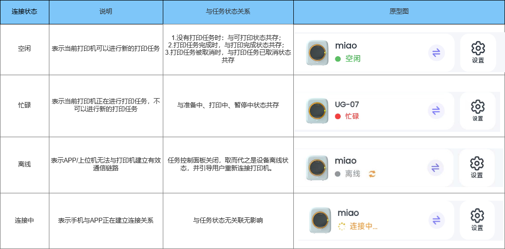
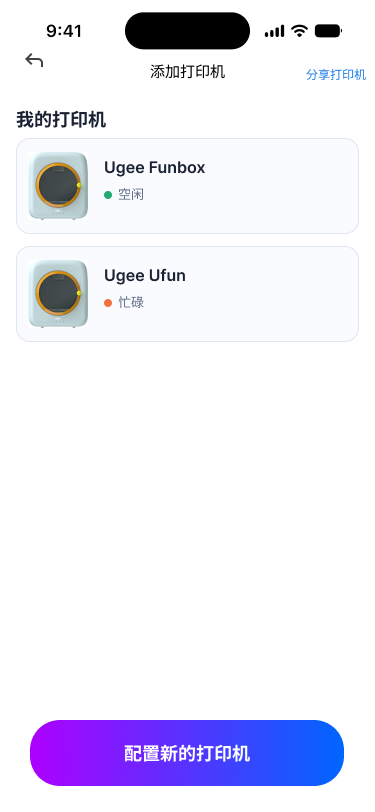
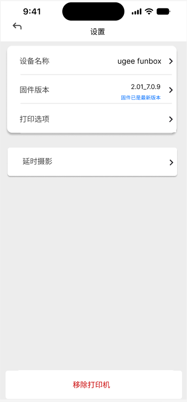
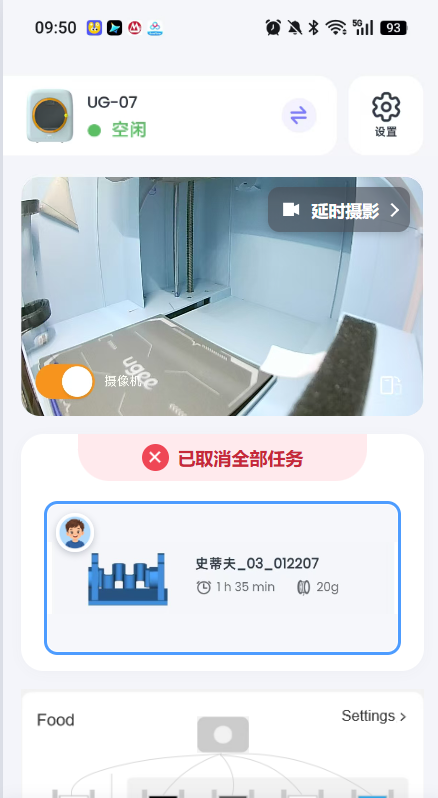

# 工作台需求文档

# 1\.版本说明

|更新时间|更新人|更新内容|
|---|---|---|
|9\.21|吴贵镜|V1\.0|

原型文件：[工作台原型](https://33ee7b3a4ab74584ad78f64a472dadf9.app.workbuddy.host/)

# 2\.背景与目标

**产品背景**

该产品服务于6\-16岁海外中产家庭孩子，通过3D打印培养孩子STEM素养和DIY创意。

已上架产品Ugee Ufun存在连接提示不清、打印控制反应慢等问题。

**账号体系背景**

一个家庭群组下的多个成员账号关联同一台打印机时，成员之间共享打印机的连接状态、设备设置、摄像头实时监控、任务控制面板和耗材控制面板。每个成员都可以连接打印机、发起打印任务和设置耗材的进料退料等，但是儿童账号只具有设备设置中**设备名称修改和延时摄影下载观看**功能权限。

详见[账号体系需求文档](https://kcns5ug7atss.feishu.cn/wiki/JFpcwG3dviHTWlkjfx3cRiQQnUf)

**目标**

通过连接配网的引导流程提升用户首次连接体验，降低连接阻力。

通过打印机连接状态面板、打印任务控制面板和耗材控制面板等模块建立用户对打印机的使用信心。

# 3\.功能清单

# 4\.页面结构

**页面旅程：设备入口页\-连接配网\-模型详情页\-准备打印页\-打印页。**

设备入口页即添加打印机页，只有连接配网完成后才呈现打印页。

[打印旅程需求文档](https://kcns5ug7atss.feishu.cn/wiki/YrlCwnjv9iN7G9kDCqycpnwDnFk)

## 4\.1连接方式与状态

**重点：连接方式为双模式连接。**

判断网络环境，优先局域网连接；其次远程云连接。

用户可在同一局域网内连接打印机，也可不在同一局域网内**远程连接控制打印机**。

##### 为什么会出现离线状态：

###### 1\.打印机未连接WiFi

**原因：**

- 首次配网失败

- WiFi密码修改

- 路由器更换

- WiFi信号弱

- 打印机断电后未自动重连

###### 2\.打印机WiFi已连接，但手机无法访问

可能原因：

- 手机连接的是另一个WiFi

- 手机处于4G/5G网络

- 路由器开启AP隔离

- 企业网络禁止设备互访

###### 3\.打印机上位机服务异常

常见原因：

- Moonraker服务停止

- Raspberry Pi/主控Linux异常

- 系统资源占满

- 服务启动失败

###### 4\.Klipper异常

原因：

- MCU通信失败

- 温度异常

- 运动异常

- 固件错误

###### 5\.MQTT/WebSocket连接断开

- MQTT Keep Alive超时

- Token失效

- 云端连接断开

###### 6\.账号绑定问题

原因：

- 更换账号

- Token过期

- 云端解绑

- 固件升级后重新认证
**解决方法**：

- 重新进入配网流程

- 检查WiFi名称和密码

- 检查2\.4GHz网络支持

## 4\.2添加打印机

|页面|逻辑|
|---|---|
| |- 只有家长账号可以绑定打印机，由家长账号将打印机分享给儿童账号。因此儿童账号不具有配置新的打印机按钮入口。 - 添加打印机页只会出现已配网且绑定的打印机。因此在加载该页面前需要先搜索附近已联网且绑定的打印机。 - 已绑定过的打印机保存至我的打印机列表中，无需重新绑定。 - 对于未配网或未绑定的打印机，支持点击“配置新的打印机”按钮跳转至连接配网引导页。 - 分享打印机功能权限仅不受限账号具备，详见[不同账号控制权限中添加打印机](https://v1uw36mubro.feishu.cn/wiki/QJDVwXrIti9xcdk51njcvsvOntg#share-WJrhdEQnBo993dxLZ52c4qxhnWb) |

## 4\.3设备设置

**重点：**

1. 受限账号只有设备名称查看修改和延时摄影本地下载观看的权限。不受限账号具有完整权限。

2. 移除打印机按钮跳转需要判断当前账号是否还有其它已绑定且处于配网状态的打印机，如果有则自动连接到该打印机，如果没有则跳转至添加打印机页。

|页面|逻辑|
|---|---|
| |- 点击打印页面的设置按钮跳转至设备设置页面。 - 该页面常规下含有： 1. 设备名称 用户可自定义设备名称。 2. 固件版本 用户可查看当前打印机固件版本，并进行更新。 在推出新的固件版本后在工作台任务控制面板下方给出当前已有新的固件版本更新标签，点击后跳转至设备设置页，点击固件版本后跳转至固件升级页。 固件升级页包含：当前固件版本、最新固件版本、更新说明、立即升级按钮和查看更多说明跳转按钮。 点击查看更多说明跳转至外部网页，该网页为本次固件更新详细内容。 点击立即升级按钮弹出二次确认弹窗“最新版本xxx，是否确认更新？”。点击确认后，固件升级页前端立即升级按钮更新为固件更新中\.\.\.。 用户可点击左上角回退按钮跳转至固件升级中的打印页。 在更新时，打印页打印机处于忙碌状态，摄像头关闭，并在前端将任务控制面板和耗材控制面板更新为固件更新进度显示区。 用户更新固件需要保证用户网络稳定，用户已连接打印机，打印机处于空闲状态。  3. 打印选项 4. 延时摄影 5. 移除打印机 - 儿童账号仅具有**设备名称、延时摄影。** |
||- 设备设置页中点击打印选项跳转至打印选项页。 - 该页面包含： 1. 缠料检测。 通过打印时的阻力判断耗材是否缠绕打结。 2. 断料检测。 通过检测耗材是否正常进料判断是否有无断料异常。 3. 提示音。 控制机器开机、任务操作、报错提示时的音效。 |
||- 在设备设置页点击延时摄影进入延时摄影页。 - 用户可下载云端存储的延时摄影视频至本地文件播放观看。 - 用户可编辑删除本地文件中的延时摄影视频。 - 只有已经完成的打印任务才能下载观看。 |
||- 设备设置页点击移除打印机弹出“是否确认移除打印机弹窗”，点击取消则返回原设备设置页面，点击确认则分为两种情况： 1. 用户没有其它已连接打印机：点击确认后跳转至添加打印机页。 2. 用户已有其它已连接打印机：点击确认后切换至其它已连接打印机并跳转至打印页。如果用户有多个其它已连接打印机则连接我的打印机中第一顺位的打印机。 - 移除打印机操作仅会移除当前连接的打印机，且不影响打印机配网状态，只取消了用户与打印机的绑定关系。 - 如果被移除的打印机依然处于配网状态，则会被识别到在同一网络内可用打印机，点击连接即可。 - 如果被移除的打印机未处于配网状态，则点击配置新的打印机按钮进入连接配网流程。 |

## 4\.4摄像头实时监控

|页面|逻辑|
|---|---|
||- 摄像头视频能力包含两个相互独立功能： 1. 实时视频监控 2. 延时摄影 - 视频质量支持360p。 - 视频链路： 1. 优先支持同局域网实时查看  2. 非局域网优先支持互联网p2p 3. 其次采用云服务器中转 - 视频流单次最高可观看30s，单账号一日最高观看3分钟，且支持自动关闭机制： 1. APP进入后台 2. APP退出 3. 网络断开 4. 打印机离线 5. 离开打印页 - 支持家庭群组内共享打印机视频流画面。 - 延时摄影视频保存至云端，支持用户下载至本地文件。 - 点击左下角按钮开关可选择打开与关闭摄像头画面。 - 点击右下角切屏按钮可切换成横屏观看模式。 - 点击右上角延时摄影按钮跳转至本地文件延时摄影页面。 - 当打印机处于离线或者连接中状态时，摄像头关闭。 |

## 4\.5任务控制面板

重点：

1. 取消按钮需要判断当前打印模型是单盘打印还是多盘打印，如果是多盘打印，弹窗需要特别给出**取消当前任务和取消全部任务两个按钮。**

2. 点击打印队列待打印任务可以跳转至打印准备页，并实时看到打印机状态、其他打印任务打印状态（已完成、正在打印、已取消）。

3. 一个家庭群组内多个账号可以在打印机处于忙碌状态下添加打印任务至打印队列。

### 4\.5\.1打印任务状态

打印任务状态为六种：**可打印**、**准备中**、**打印中**、**已暂停**、**已取消**和**打印完成**。

|**任务状态**|**页面**|**逻辑**|**页面结构与交互**|
|---|---|---|---|
|可打印 ||- 用户成功绑定打印机后，任务控制面板默认为可打印状态。 - 点击探索玩具跳转至模型首页，点击我的模型跳转至本地文件中模型页面。  |**顶部状态栏** 位置：顶部居中。 内容：“可打印”标题。 颜色：主题色为绿色。 **模型导航区** 位置：中间上部 内容：引导文案和跳转按钮。 引导文案：快挑选一个玩具开始创造吧。 跳转按钮有两个，左右平齐。  左侧按钮为探索玩具按钮，按钮样式：橙色边框，橙色字体：探索玩具，空白按钮背景； 右侧按钮为我的模型按钮，按钮样式：无边框，白色字体：我的模型，渐变色背景，左侧为紫色，右侧为蓝色。 点击后按钮被半透明灰色遮罩，并跳转页面。 |
|准备中 ||- 在打印设置页面点击开始打印按钮跳转至打印页后，任务控制面板转变为准备中状态。 - 准备中状态承接打印任务的切片加载、流量校准、调平归零和喷嘴升温的等待过程。 - 对于单盘打印模型，点击取消按钮后弹窗，提示”是否取消任务“，提供暂不和取消任务按钮。 - 点击暂不则返回准备中状态；点击取消任务则面板进入已取消打印任务状态。 - 对于分多盘打印模型，点击取消按钮后弹出弹窗，提示“是否取消任务”，提供取消当前任务、取消全部任务按钮和关闭弹窗按钮。 - 点击取消当前打印任务按钮则任务状态面板转为打印任务已取消，面板中只有模型展示区和打印队列，无打印进度，且不影响打印队列。 - 点击取消全部任务按钮则任务状态面板转为已取消全部任务，面板中只有模型展示区和打印队列，打印队列中该模型的其它盘的待打印任务被剔除出打印队列。 - 取消任务只会取消单盘模型的单个任务或多盘模型下的全部任务，不影响其它账号的待打印任务。 - 只有用户在弹窗中确定取消任务后，打印机才中断打印前准备流程。 - 点击取消当前任务/取消全部任务/取消任务按钮后弹出取消中弹窗，用户可关闭弹窗，取消按钮转为取消中\.\.\.，原型参考打印中状态。 |**顶部状态栏**  位置：顶部居中。                内容：“准备中”标题。  颜色：主题色为紫色。 **模型展示区**  位置：中间上部。  内容：模型图、模型名称、打印时间和耗材克重。  布局：左图右字。 **准备打印区**  位置：中间下部。  内容：准备打印标签、等待图标、等待文案和进度百分比。  等待文案具有前后演进顺序，其内容及顺序为：“正在分析模型”\-“校准中”\-“擦嘴中”\-“归零中”\-“调平中”\-“升温中”。  布局：准备打印标签位于该区域左侧顶部，与模型展示区左侧对齐，等待图标与等待文案及进度百分比位于准备打印标签下方居中显示。 **底部按钮**  位置：底部居中  行为：弹出是否取消任务确认弹窗。|
|打印中 ||- 准备中状态结束后自动进入打印中状态。 - 实时显示打印时间倒计时、进度条和进度百分比。 - 对于分多盘打印模型，在打印设置页面选择的盘优先开始打印，剩余盘进入打印队列。 - 点击暂停按钮后，立刻弹出暂停中弹窗，用户可关闭弹窗，暂停按钮转为暂停中\.\.\.，等待暂停指令执行后，任务控制面板由打印中转变为已暂停状态。 - 当处于暂停中时，用户不可以进行取消操作。 - 取消按钮的响应逻辑与准备中状态下的取消按钮保持一致，区分单盘和多盘弹窗。 - 点击取消当前任务/取消全部任务/取消任务时，立刻弹出取消中弹窗，用户可关闭弹窗，取消按钮转为取消中\.\.\.，等待取消指令执行后，任务控制面板由打印中转为已取消打印任务状态。 - 点击打印队列等待打印任务跳转至打印设置页面。对于已打印或者正在打印的盘，在准备打印页面打上标签标识。 - 打印设置页面分为两种： 1. 打印机处于空闲状态 用户可以点击开始打印按钮。 2. 打印机处于忙碌状态 用户不可以点击开始打印按钮。   |**顶部状态栏**  位置：顶部居中。  内容：“打印中”标题。  颜色：主题色为蓝色。 **模型展示区**  位置：中间上部。  内容：模型图、模型名称、打印时间和耗材克重。  布局：左图右字。 **打印进度区**  位置：中间下部。  内容：剩余时间标签、倒计时、进度条和完成百分比。  布局：该区左侧顶部为剩余时间标签，该标签下方为倒计时，倒计时下方为进度条。  说明：实时显示打印进度状态，原型中完成按钮为演示需要，实际模块无该按钮。 **控制按钮**  位置：中间下部左右两个按钮平齐。  内容：左侧按钮为暂停按钮，右侧按钮为取消按钮。  行为：点击暂停按钮则打印任务控制面板进入**已暂停**状态；点击取消按钮则弹出是否取消任务弹窗。 **打印队列**  位置：底部陈列。  交互方式：下拉菜单展开与收缩打印任务队列。下拉展开等待打印任务队列，等待打印任务上下分区显示，包含模型展示和等待打印标签。|
|已暂停 ||- 打印中状态点击暂停按钮后进入已暂停状态。 - 打印倒计时和打印任务进度百分比暂停。 - 点击继续按钮立刻弹出继续打印中弹窗，用户可关闭弹窗，继续按钮转为继续中\.\.\.状态，等待继续指令完成后，任务控制面板返回打印中状态。 - 当处于继续中状态时，无法进行取消操作。 - 点击取消按钮弹窗与响应逻辑与准备中状态保持一致。 - 点击打印队列等待打印任务跳转逻辑与打印中状态一致。 |**顶部状态栏**  位置：顶部居中。  内容：“已暂停”标题。  颜色：主题色为黄色。 **模型展示区**  位置：中间上部。  内容：模型图、模型名称、打印时间和耗材克重。  布局：左图右字。 **打印进度区**  位置：中间下部。  内容：已暂停标签、倒计时、进度条和完成百分比。  布局：该区左侧顶部为已暂停标签，该标签下方为倒计时，倒计时下方为进度条，  说明：实时显示打印进度状态，原型中完成按钮为演示需要，实际模块无该按钮。 **控制按钮**  位置：中间下部左右两个按钮平齐。  内容：左侧按钮为继续按钮，右侧按钮为取消按钮。 **打印队列**|
|已取消 ||- 已取消打印任务状态没有打印进度。 - 对于分盘打印模型，只取消当前任务后，可以在打印队列点击该模型其它盘的任务进行打印。对于被取消的盘，打上已取消标识标签。 - 对于单盘打印模型取消打印任务或者多盘打印模型取消全部任务不影响打印队列中其它账号的待打印任务。  |**顶部状态栏**  位置：顶部居中。  内容：“已取消打印任务”标题。  颜色：主题色为红色。 **模型展示区**  位置：中间上部。  内容：模型图、模型名称、打印时间和耗材克重。  布局：左图右字。 **打印队列** |
|打印完成 ||- 打印时间归零后，任务控制面板自动由打印中状态进入打印完成状态。 - 点击重新打印按钮后进入准备中状态。此时准备中状态只承接打印机喷嘴头升温的等待时间。 - 点击下一盘按钮按照打印队列顺序开始下一盘打印任务，任务面板转为下一盘打印任务的准备中。 - 点击打印队列等待打印任务跳转逻辑与已取消打印任务状态一致。 |**顶部状态栏**  位置：顶部居中。  内容：“打印完成”标题。  颜色：主题色为绿色。 **模型展示区**  位置：中间上部。  内容：模型图、模型名称、打印时间和耗材克重。  布局：左图右字。 **打印进度区**  位置：中间下部。  内容：打印完成标签、倒计时、进度条和完成百分比。  布局：该区左侧顶部为打印完成标签，该标签下方为倒计时，倒计时下方为进度条。 **控制按钮**  位置：中间下部左右两个按钮平齐。  内容：左侧按钮为重新打印按钮，右侧按钮为下一盘按钮。 **打印队列** |

**打印队列管理规则：**

1. 只有分盘打印模型的分盘任务或者其它成员在打印机处于忙碌状态下添加的打印任务才会进入打印队列等待打印。

2. 点击下一盘直接按照打印队列顺序开始打印队列中位于第一位置的待打印任务。

### 4\.5\.3打印状态机

#### 状态机设计目标

打印状态机用于统一描述一条打印任务从创建、准备、打印、暂停、取消到完成的完整生命周期。

状态机需要同时满足：

- APP能够准确展示当前打印任务状态；

- 固件/上位机能够明确上报任务状态；

- APP、服务器和打印机对状态定义保持一致；

- 网络断开不直接改变打印任务实际状态；

- 多账号场景下所有家庭成员查看同一份任务状态；

- 用户控制操作必须根据当前状态判断是否允许执行。

---

#### 打印任务基础状态

---

#### 基础状态流转

## 4\.6耗材控制面板

重点：

1. 耗材来源方式分为**机身料架和小书包（类似自研料箱）**，APP需要支持自动识别，并在耗材控制面板与打印准备中自动以料架或者小书包的方式呈现。

2. 进料与退料支持中途退出，并在耗材控制面板实时更新进料、退料完成状态。

3. 打印机不能自动识别耗材颜色和类型，在用户安装耗材后，APP识别到耗材并自动给出一个随机颜色和一个基础耗材类型，因此需要用户手动完成修改。

|页面|逻辑|交互设计|
|---|---|---|
||- 在打印页耗材控制面板上方给出一个风扇滤芯剩余使用时长标签，点击后跳转至更换风扇滤芯页面。     - 点击更换风扇滤芯页中立即购买按钮跳转至官方电商页面     - 点击我已更换则跳转回打印页，并更新剩余使用时间为一个标准滤芯使用时长。 - 支持开关过滤风扇，并给出使用时长，在达到规定使用时长后给出更换滤芯弹窗提示。 - 首次弹窗提示“风扇使用已超过规定时间，请及时更换滤芯”，并给出确定按钮，点击后跳转至原页面。 - 在用户第二次启动APP后，进行二次弹窗，给出已更换和确定按钮，两个按钮点击后都跳转至原页面。 - 如果用户点击已更换则不再弹窗提醒，如果用户依旧只点击了确定，则进行第三次弹窗，弹窗在下一次启动APP时触发，且最多只能进行三次弹窗提醒，第三次弹窗无论用户点击已更换还是确定按钮都不再触发弹窗。 ||
||- APP支持自动识别打印机连接耗材来源： 1. 料架（与Ugee Funbox一样） 2. 小书包（在原有料架位置进行安装）     - 支持四个料槽料盘打印。     - 支持手动修改不同料槽料盘耗材颜色和类型。     - 默认不选中任何料槽料盘。 两种耗材来源只能二选一。 - 打印机不支持自动识别耗材颜色和类型，因此在用户安装并送入耗材时，弹出弹窗“打印机已检测到耗材，可以手动修改耗材颜色和类型”。点击去设置按钮跳转至耗材设置页面。 - 点击每个料盘下方修改图标跳转至耗材设置页面。 ||
||- 只有选中其中一个料槽料盘才能进行进料或退料。 - 对于一个尚未进料或正在进料的料盘无法执行退料。 - 对于一个尚未退料或正在退料的料盘无法执行进料。 - 在进料中或退料中页面回到打印页后，耗材控制面板显示“进料中”和“退料中”状态，且原进料按钮文字变为“进料中\.\.\."，原退料按钮文字变为“退料中\.\.\.”。 - 在进料和退料完成后，在耗材控制面板显示“x号料盘进料/退料完成”。 ||
||- 点击耗材控制面板进料按钮跳转至进料中页面。 - 进料过程分为三步： 1. 加热喷嘴温度 该步骤耗时较长，在进入进料中页面后5\-10s内展示Toast”加热时间较长，请耐心等待“。 2. 抽回当前耗材 3. 送出新耗材 用户点击取消按钮可中止进料进程，用户点击回退按钮不中断进料进程。 进料完成后用户可点击完成按钮跳转至打印页。|- 加热喷嘴温度时，喷嘴温度圆盘实时显示当前喷嘴加热温度。 - 插入示意图或动图标识耗材的抽回与送出。|
||- 点击耗材控制面板退料按钮跳转至退料中页面。 - 退料过程分为两步： 1. 加热喷嘴温度 该步骤耗时较长，在进入进料中页面后5\-10s内展示Toast”加热时间较长，请耐心等待“。 2. 退出当前耗材 用户点击取消按钮可中止退料进程，用户点击回退按钮不中断退料进程。|同进料。|
|   |- 对于官方耗材，料箱支持开机自启动识别耗材类型和颜色。 - 对于官方和非官方耗材，都支持用户手动修改耗材类型和颜色。 - 支持用户修改耗材名称。通用名称默认设置为ugee PLA。 - 不同耗材类型喷嘴温度不同，且不可修改。 - 耗材类型支持PLA多种类型，如 1. PLA Basic 2. PLA Plus 3. PLA Matte 4. PLA Silk 5. PLA High Speed ||

